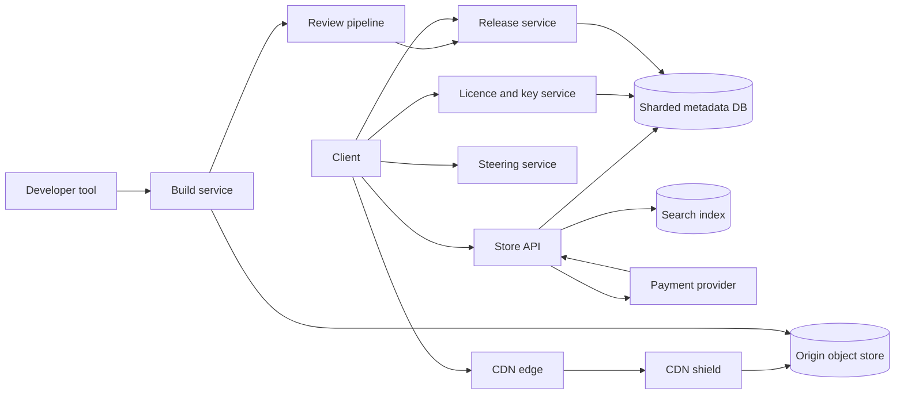

# Digital Game Store and Distribution (Steam-style)

[English](README.md) · [中文](README.zh.md)

<!-- meta:begin -->
| Type | Priority | Difficulty | Roles | Topics | Round |
| --- | --- | --- | --- | --- | --- |
| System design | ★☆☆☆☆ | Hard | SWE · Infra Eng | cdn, object-storage, licensing, delta-updates | Onsite |
<!-- meta:end -->

## Problem

Design a digital game store and distribution platform. The objects are: a *title*, a game sold in the store; a
*build*, one immutable version of a title's files; a *licence*, the record that one user owns one title; the
user's *library*, the set of titles for which they hold an active licence; and a *developer*, an account that
uploads builds of its own titles. Users run a desktop *client* on a machine identified by a `device_id`.

Part 1, ownership. A user browses the catalogue, where each title has metadata, a price per region and a
regional availability status. A user buys a title; when the payment provider reports success, a licence is
created and the title appears in the user's library. The client downloads the installer of a library title,
which is large, and later downloads patches that bring an installed build to a newer build. Before
downloading or launching a title the client must prove that its user holds an active licence. A title must be
launchable without network access for a bounded time, and a licence can be revoked (refund, chargeback,
account ban).

Part 2, publishing. A developer uploads a build. The build goes through *review*, after which it is approved
or rejected; an approved build is *published* by pointing a *branch* (a named release channel, for example
`stable`) at it. A publish can be *rolled out* gradually to a share of users, restricted to some regions or to a
named cohort, and can be *rolled back* to the previous build.

Part 3, product APIs. List all titles; search titles; block a title in selected regions; keep the system
healthy when a popular title is released and a very large number of users want it at the same moment.

The object store holds immutable byte blobs under string keys, with conditional create-if-absent writes,
multipart upload and pre-signed URLs. A CDN (content delivery network) is a hierarchy of caches that serves
blobs close to users: *edge* caches inside or beside user networks, then a *shield* cache per region, then the
object store as *origin*. The metadata store is a sharded transactional relational database. A payment
provider reports the outcome of a payment by a webhook that may be delivered more than once.

Scale for this design:

- 120,000,000 registered users, 30,000,000 daily active users, 9,000,000 online at the daily peak. A user
  holds 35 licences on average.
- 90,000 titles. A build averages 8 GiB across the catalogue; by download volume the average installed title is
  30 GiB. 3,000,000 installs and 14,000,000 patch downloads per day. A typical patch changes the content of
  500 scattered regions of about 200 KiB each.
- 1,200,000 purchases per day on average; during a sale event the purchase rate is 30 times its daily average.
  Each daily active user views 20 catalogue pages and launches a title 3 times per day.
- 40,000 developer accounts upload 2,500 builds per day; a build averages 15 GiB and 4% of its content is
  new to the platform.
- One launch event: a 60 GiB title with 2,500,000 pre-orders. Release time is T0. Of the pre-orders, 2,000,000
  users start the title within 10 minutes after T0, and 400,000 further users buy it in the first hour.
- Targets: catalogue page 200 ms at the 95th percentile; a purchased title appears in the library within
  5 seconds of payment success; a licence check 100 ms at the 99th percentile; a revocation takes effect for an
  online client within 5 minutes; a title launches offline for up to 14 days.

In scope: the catalogue, purchase and library path; the licence model and its offline and revocation
behaviour; the layout of build data, its transfer to clients through the CDN and the patch mechanism; the
developer upload, review, publish, rollout and rollback pipeline; the launch-day load; regional availability;
list and search. Out of scope: payment processing internals, tax, the content of the review itself, the
client's UI, game-side anti-cheat, and community features (reviews, friends, chat).

Produce:

1. Requirements and a scale estimate: download egress at average and peak, how much of it reaches the origin,
   CDN and origin storage, upload volume, store and licence request rates, and the traffic of the launch
   event.
2. A data model and the core APIs for the store, the client and the developer.
3. An architecture diagram, with a walk-through of one purchase followed by an install, and of one build
   from upload to a published release.
4. Deep dives into: (a) how builds are laid out and delivered, and how patches work; (b) licences, offline
   play and revocation; (c) review, publishing, rollout and rollback; (d) the launch-day spike; (e) enforcing
   regional availability.

## Reference solution

<details>
<summary>Show the reference solution</summary>

Worth confirming first: whether licences can be lent or transferred (assumed not; a refund within the
refund window revokes the licence); how strong the copy protection must be (assumed: it keeps honest
accounts honest and limits casual sharing, it does not resist a determined attacker on their own machine);
and whether a regional block applies only to new sales or also to owners (assumed: both kinds exist, deep
dive (e)).

### Requirements and scale

Every figure below is recomputed in the check at the end.

**Download egress.** Installs move 3,000,000 × 30 GiB ≈ 85.8 PiB per day and patches 14,000,000 × 0.6 GiB
≈ 8.0 PiB, together 93.8 PiB per day, an average of about 9.8 Tbps. Players concentrate in the evening, so
the design is sized for 2.5 times the average, about 24.5 Tbps. No origin could serve this: the CDN has to
carry almost all of it. With a 90% hit rate at the edge and a shield that absorbs 70% of what the edges miss,
the origin sees 10% × 30% = 3% of the traffic: about 0.29 Tbps on average and 0.73 Tbps at peak.

**Patch size.** The unit of transfer is a chunk of average size 1 MiB (deep dive (a)). A changed region of
length L touches about L divided by the chunk size, plus one, chunks. With 500 regions of 200 KiB, a patch
fetches about 500 × (0.2 + 1) ≈ 598 chunks ≈ 0.6 GiB, 2% of a 30 GiB build, which is where the 0.6 GiB above
comes from. Shipping every patch as a full build instead would cost 14,000,000 × 30 GiB ≈ 400 PiB per day,
50 times more.

**Storage.** The catalogue holds 90,000 × 8 GiB ≈ 703 TiB of current builds. Older builds are kept for
rollback and are mostly made of the same chunks, so unique chunks add about 60%: roughly 1.1 PiB, about
1.2 billion chunk objects of 1 MiB, in the origin object store. Developers upload 2,500 × 15 GiB ≈ 36.6 TiB
of build data per day, of which only 4%, 1,500 GiB, is new; that is about 535 TiB per year before garbage
collection removes chunks of builds past the retention window. Each of 20 shield regions caches the working
set of about 3,000 hot titles, 3,000 × 30 GiB ≈ 88 TiB per region, 1.7 PiB in all.

**Store and licence load.** Purchases average 1,200,000 / 86,400 ≈ 13.9 per second and reach about 417 per
second in a sale, a small load for the database and the payment provider's limit is the real bound.
Catalogue pages: 30,000,000 × 20 / 86,400 ≈ 6,900 per second on average and 21,000 at a 3 times peak, almost
all served from cache. Licence rows: 120,000,000 × 35 = 4.2 billion at about 100 bytes, 391 GiB, 6 GiB per
shard over 64 shards. Launch checks: 30,000,000 × 3 / 86,400 ≈ 1,040 per second, 4,200 at a 4 times peak, plus
417 per second of heartbeats (9,000,000 online clients, one every 6 hours). All of them are verified by a
signature, not by a database read (deep dive (b)).

**Launch event.** The preload moves 2,500,000 × 60 GiB ≈ 143 PiB. If 60% of it moves in the first 24 hours,
that is 85.8 PiB, 8.9 Tbps on average and about 18 Tbps at a 2 times peak, on top of the usual traffic.
Delivered after T0 instead, the same bytes in one hour would need about 360 Tbps; that is why the bytes must
move before T0 (deep dive (d)).

### Data model and API

**Title** — `app_id`, `developer_id`, name, description, tags, `state`. **Price** — `(app_id, region)`,
currency, amount. **RegionRule** — `app_id`, `scope` (a region code or `*`), `status` (`allowed | blocked`),
`kind` (`sales | legal`), `effective_from`, `seq`.

**Order** — `order_id`, `user_id`, `app_id`, amount, `billing_country`, `state`
(`created | paid | failed | refunded`), `idempotency_key`, `rule_seq`. **Licence** — primary key
`(user_id, app_id)`, `source` (`order | gift | key`), `order_id`, `state` (`active | revoked`), `version`,
`granted_at`. Both tables are sharded by `user_id`, so a user's library is a single-shard range scan.

**Build** — `build_id`, `app_id`, `manifest_id`, `state` (`uploaded | in_review | approved | rejected`),
`key_epoch`, `created_at`. The manifest is an immutable object `manifests/{build_id}` (deep dive (a)).
**Branch** — `(app_id, name)` → `build_id`, plus a version for compare-and-swap. **Rollout** — `rollout_id`,
`app_id`, `build_id`, `percent_bp` (basis points, 10,000 = everyone), `regions`, `cohort_id`, `state`
(`active | paused | aborted | complete`).

Chunk objects live under `chunks/{id[0:2]}/{id}`, where `id` is the SHA-256 of the chunk as stored (encrypted).
Nothing in the metadata store records which builds use a chunk: the garbage collector derives it from the
manifests.

Core APIs:

1. Store: `GET /titles?cursor=&limit=&region=` lists all titles with a keyset cursor on `app_id`;
   `GET /search?q=&region=`; `GET /titles/{app_id}`; `POST /orders` with an `Idempotency-Key` header;
   `GET /library`.
2. Payment webhook: `POST /payments/events`, idempotent on `order_id`.
3. Client: `POST /licences/{app_id}/token` with `{device_id}` → a signed licence token;
   `GET /apps/{app_id}/update?installed=<build_id>` → `{build_id, manifest_url}`;
   `POST /apps/{app_id}/key` with a token → the title key wrapped for the device.
4. Developer: `POST /builds`; `POST /builds/{id}/chunks:missing` with chunk ids → the ids not yet stored, plus
   pre-signed upload URLs; `POST /builds/{id}/commit`; `PUT /apps/{id}/branches/{name}` with the expected
   current build; `POST /apps/{id}/rollouts`; `POST /apps/{id}/rollouts/{rid}:abort`.
5. Operations: `PUT /apps/{id}/regions/{region}` with `{status, kind}`.

Search is an inverted index fed from the `Title` table by a change stream. Each document carries its name,
tags, a popularity score and its set of blocked regions; ranking is text relevance multiplied by the
logarithm of popularity. Because the index lags the table by seconds, the API re-checks regional availability
against the rules for every result it returns.

The purchase flow: `POST /orders` checks availability and price in the buyer's region, writes the order in
state `created` and returns a payment session. The webhook handler then runs one transaction on the user's
shard: set the order to `paid` and insert the licence, with the primary key `(user_id, app_id)` making a
redelivered webhook or a second purchase of the same title a no-op. The client learns of the licence by a
push on its persistent connection, with a poll on the library every few seconds as a fallback.

### Architecture



A purchase goes to the Store API, which checks availability and creates an order and a payment session; the
provider's webhook turns the order into a licence in the database. The client then asks the Licence service
for a token, asks the Release service which build it should have, fetches the signed manifest, obtains the
title key and downloads the chunks the manifest lists. The Steering service answers with a ranked list of
cache hosts for the client's network, and the client reads chunks from the edge, which falls back to the
shield and then to the origin. A build arrives from the developer tool as chunks written straight to the
origin through pre-signed URLs, then passes through the Review pipeline, and the Release service moves
branch pointers and rollouts, which clients see at their next update check.

### Deep dives

**(a) Build layout, delivery and patches.** Two ways to ship an update: a pairwise diff between two specific
builds, or chunk-level set difference. A pairwise diff is small, but clients sit on many different old builds,
so the number of pairs grows with the number of builds and each must be generated and cached before anyone asks.
This design therefore splits every build into chunks, identifies a chunk by its hash, and makes an update
"the chunks of the target manifest that are not on disk". It works from any installed build to any target,
with nothing precomputed per pair.

Chunk boundaries are chosen by content (content-defined chunking with a rolling hash, here a gear hash: a
boundary is declared where the hash of the last 32 bytes has a fixed pattern, with minimum 256 KiB, maximum
4 MiB and average 1 MiB). A boundary depends only on nearby bytes, so inserting bytes into a pack file moves
the boundaries near the insertion and leaves the rest alone. Fixed-size chunks would shift every later chunk
after an insertion and download almost the whole file again; the check shows 95% and above for fixed-size
against under 10% for content-defined chunks on the same edit.

A manifest lists, per file, its chunks as `(chunk_id, plaintext_sha256, size)` — 72 bytes each, about 2.1 MiB
for a 30 GiB build — plus the build id and a signature by the platform. The client verifies the manifest
signature and each chunk's plaintext hash after decryption, so neither a faulty cache nor a tampered response
can plant bytes in an install. The client installs by writing chunks into a staging area and switching to the
new files at the end, so a failed update leaves the old build intact; it keeps a per-chunk progress record, so
a download resumes at chunk granularity.

Chunks are compressed and then encrypted with a title key. The nonce is derived from the chunk's plaintext
hash, so a chunk unchanged between builds has the same bytes, the same id and is stored once; the same chunk
in another title has a different key and a different id. Encryption is what makes the CDN simple: the bytes
are useless without the key, so chunk URLs need no per-user authorization and the CDN caches by chunk id
alone, for ever, because a chunk id never changes meaning. Signing a URL per chunk would instead be
3,000,000 installs × 30,720 chunks ≈ 92 billion signatures per day and a different cache key for each user.
Ownership is enforced where it is cheap, at the manifest and key endpoints (deep dive (b)).

Routing. The client asks the Steering service for a ranked list of hosts for its network (its autonomous
system and region), preferring caches inside its own internet provider, then the nearest edge, then others,
with live load and health taken into account. It runs 8 to 16 parallel connections across hosts, abandons a
slow host and retries a failed chunk elsewhere. Steering is a lookup of a precomputed table, not a per-request
computation.

At the edge a chunk is a fixed small object, so cache efficiency is the number of distinct chunks times
request locality. The shield collapses simultaneous misses for the same chunk into one origin request, so the
origin sees one fetch per chunk per shield region rather than per user.

**(b) Licences, offline play and revocation.** Two ways to check ownership at launch: ask the Licence service
every time, or have the client verify a signed token that the service issued earlier. Asking every time is
simple and immediately revocable, but it makes launches depend on the network, which breaks offline play, and
it puts the licence database on the path of every launch spike. The signed token is verified locally with the
platform's public key and needs no round trip. The cost is that a token already issued cannot be recalled, so
revocation latency is bounded by the token's life; the design makes that explicit.

A token carries `user_id`, `app_id`, `device_id`, licence `version`, `not_before`, `expires` and a key id
for signing-key rotation, signed with an asymmetric key (Ed25519). It is issued when the licence service finds
an active licence. While online the client re-asks every 6 hours (the heartbeat) and every launch, and the
issued life is 14 days, which is also the maximum offline period. Offline, the client checks signature, device,
validity window and a clock guard: it stores the latest time it has ever seen and refuses to run when the
system clock is earlier than that, which stops resetting the date to extend a token.

Revocation sets `state = revoked` and increments `version` in the licence row, in the same transaction as the
refund or ban. An online client is told in two ways: the service pushes a revocation on the client's
persistent connection, taking seconds, and the next heartbeat or launch gets no new token and the key
endpoint refuses, within the 6 hour bound at worst. A client that stays offline keeps its token until it
expires; 14 days is the accepted exposure for ordinary titles, and the design can shorten the life for titles or
accounts flagged as risky. The licence database is read only when a token is issued or refreshed, about
1,040 launches and 417 heartbeats per second, which is why 64 shards are ample.

Where the title key stands in this: the key endpoint takes a token, checks it and the current licence version
(a cached revocation set per shard, not a database read), and returns the title key wrapped for the device's
public key. Without a key, downloaded chunks cannot be read, so a revoked or non-owning account that has
copied every chunk gains nothing.

Purchases and licences must not disagree. The webhook handler is idempotent and commits the order state and
the licence in one transaction on one shard, so a licence exists if and only if an order is paid. A refund
sets the order to `refunded` and the licence to `revoked` in one transaction.

**(c) Review, publishing, rollout and rollback.** *Upload.* The developer tool chunks and encrypts the build
locally with the same procedure as the platform, sends the chunk ids, and receives the ones not already stored
with pre-signed upload URLs; 96% of the data is already stored for a typical new build. It then calls `commit`,
which verifies that every chunk in the manifest exists and that the manifest hash matches, and creates the build
in state `uploaded`.

*Review.* An automated stage (scanning for malware, checking the manifest against declared platform and size
limits) runs on a copy of the build decrypted inside an isolated worker; builds from a first release or a
flagged developer then go to manual review. The states are `uploaded → in_review → approved | rejected`. Only an
`approved` build can be pointed at.

*Publish.* Publishing sets the branch pointer by compare-and-swap on its version, with the build the caller
believed was current: two operators acting at the same moment cannot both win without noticing.

*Rollout.* A rollout is a rule over the pointer: `percent_bp`, optionally restricted to a list of regions, plus
optional cohorts that always get the new build (testers). To resolve a client, the Release service goes through
the active rollouts newest first, skips those whose regions exclude the user, and gives the rollout's build to
members of its cohort or to users whose bucket is below the percentage; otherwise the answer is the branch
pointer. The bucket is `SHA-256(rollout_id : app_id : user_id) mod 10,000`: deterministic, so a user never
flips between builds on repeated checks; and monotonic, so raising 5% to 20% only adds users. The service
holds all rules in memory, refreshed every 10 seconds, so an update check is a computation on the client's
request with no database read.

*Rollback.* Abort the rollout and everybody not yet moved resolves to the pointer again; if the new build was
already the pointer, move the pointer back to the previous build in one compare-and-swap. A client that
installed the bad build receives a target that is the old build; because the chunks are mostly shared, the
delta is the set of chunks the bad build changed, the same cost as an ordinary patch. An emergency rollback
is pushed on the persistent connection so clients check at once instead of at their next scheduled check.

*Retention.* A mark-and-sweep garbage collector marks every chunk of every manifest for builds that are
a branch or rollout target, are among the last 10 builds of a title, or are younger than 30 days. It deletes
unmarked chunks that have been unmarked for 7 days; the grace covers chunks that a developer tool uploaded and
has not yet committed. The mark phase reads manifests only; it never trusts a chunk count.

**(d) The launch-day spike.** If downloading began at T0, 2,500,000 × 60 GiB in one hour would be about
360 Tbps and no one could buy the capacity. The design moves the bytes before T0 and leaves only a small,
cheap action for T0.

*Before T0.* The build is committed, reviewed and published to a locked pre-release branch several days before
release, together with the final day-one patch, so no patch is needed afterwards. Its encrypted chunks go to
the shields and edges ahead of the pre-order window, during off-peak hours; the origin sends 20 shields × 60 GiB
≈ 1.2 TiB, a fraction 0.000008 of the 143 PiB that clients eventually fetch, i.e. 99.9992% offload. Owners of a
pre-order receive the manifest and start the preload; the client throttles itself at off-peak hours and
does not start all at once. The key is not issued: the chunks are ciphertext and nothing in them is playable.

*At T0.* The key service holds the title key in its memory, loaded shortly before T0 from the key-management
system and refusing every request before T0 by its own clock. A client that has preloaded and knows T0 waits a
random delay of 0 to 120 seconds and then asks for the key with its licence token. Without that jitter,
2,000,000 clients in 10 minutes means about 3,300 requests per second, and in the first seconds far more;
with a 120 second spread it is about 16,700 per second at a flat rate. Each request is a signature check and a
key wrap of 200 bytes, no database read: a few CPU cores, which is why the service is stateless and scales
out. The 400,000 buyers in the first hour download from warm caches and only cold chunks reach the origin.

*Hot titles in general.* Per-title, per-region request counts are aggregated from CDN logs every minute. Titles in
the top ranks are pre-positioned into the shields and the edges of regions where their demand is growing, and
the popular list is a precomputed result refreshed every minute and cached for the same duration. Catalogue
pages are cached at the CDN keyed by region with a short TTL, so a launch does not turn into a stampede
on the Store API. Purchases are admitted through a queue per payment provider with a rate limit, the limit
returning a retry-after to clients; this keeps the provider under its quota and the order write path steady.

**(e) Regional availability.** A block can mean "stop selling" (a sales block: a licensing agreement, a
publisher decision), or "stop distributing" (a legal block: a court order). Rules are `RegionRule` rows. To
evaluate a title for a region, take the latest rule in effect for the region scope and for the `*` scope,
and a region rule beats the global one; no rule means allowed. Rules are replayed into an in-memory snapshot
on every API node, reloaded when the rule set changes, so propagation takes tens of seconds.

The region used is the account's store region together with the billing country at purchase, not the IP
address on its own: an IP address is a signal to flag, not a basis for a decision, because VPN users and
travellers would flap.

Enforcement is at the points where a decision costs a few microseconds and cannot be bypassed:

1. *Catalogue and search.* Blocked titles are removed from list and search results for the region and show
   "not available" on the title page. The search index holds a blocked-regions field, and the API re-checks
   each result.
2. *Purchase.* `POST /orders` evaluates the rule in the same request that creates the order and stores the
   rule's `seq` on the order, so a block committed concurrently is visible in the audit trail of the sale.
3. *Token and key.* For a legal block, the licence service refuses tokens and the key endpoint refuses keys
   for the blocked region, and the block bumps licence versions for affected owners so online clients lose
   access through the revocation push; for a sales block, owners keep playing and re-downloading, and only
   new purchases stop.

The CDN is deliberately not the enforcement point. Chunks are shared across regions (that is the point of
content addressing), and a request carries no user identity to check against, so a geo block at the cache
would be both unreliable and unable to tell owners from non-owners. Because chunks are ciphertext, the
authoritative control is the key: a blocked region cannot read what it can fetch. Geo rules at the edge are
defence in depth for ordinary traffic only.

### Follow-ups

- Peer-to-peer transfer between machines on one local network would cut internet-provider egress during
  launches; chunk hashes already make every piece verifiable from an untrusted source.
- A binary diff inside changed chunks (bsdiff-like) would shrink a patch below chunk granularity, at the cost of
  per-pair patch generation, which the chunk design avoided; worth it only for large, hot titles.
- A leaked title key cannot be recalled for chunks already published; rotate `key_epoch` for the next build and
  re-encrypt on the next update, accepting that old builds stay readable by the leaker.
- Family sharing: a lease of a licence, with its own token and a revocation that follows the owner's.
- Account-bound cloud save data needs its own conflict-resolution protocol, separate from build delivery.

<details>
<summary>Estimate and behaviour check (runnable)</summary>

```python
import hashlib, hmac, json, random
import numpy as np

GiB, TiB, PiB = 1024 ** 3, 1024 ** 4, 1024 ** 5
tbps = lambda nbytes, seconds: nbytes * 8 / seconds / 1e12            # 1 Tbps = 10^12 bit/s

# --- traffic: installs and patches ---
installs_per_day, install_gib, patches_per_day, patch_gib = 3_000_000, 30, 14_000_000, 0.6
install_pib = installs_per_day * install_gib * GiB / PiB
patch_pib = patches_per_day * patch_gib * GiB / PiB
total_pib = install_pib + patch_pib
assert (round(install_pib, 1), round(patch_pib, 1), round(total_pib, 1)) == (85.8, 8.0, 93.8)
avg_tbps = tbps(total_pib * PiB, 86_400)
peak_tbps = 2.5 * avg_tbps
assert (round(avg_tbps, 1), round(peak_tbps, 1)) == (9.8, 24.5)
edge_miss, shield_miss = 0.10, 0.30                                    # edge hit 90%; shield absorbs 70% of the rest
origin_share = edge_miss * shield_miss
assert abs(origin_share - 0.03) < 1e-12
assert (round(avg_tbps * origin_share, 2), round(peak_tbps * origin_share, 2)) == (0.29, 0.73)
full_redownload_pib = patches_per_day * install_gib * GiB / PiB        # shipping every patch as a full build
assert round(full_redownload_pib, 1) == 400.5 and round(full_redownload_pib / patch_pib) == 50

# --- patch size from chunk granularity ---
avg_chunk_mib, regions, region_kib = 1.0, 500, 200
chunks_touched = regions * (region_kib / 1024 / avg_chunk_mib + 1)     # a region of length L touches about L/C + 1 chunks
assert round(chunks_touched) == 598
assert round(chunks_touched * avg_chunk_mib / 1024, 1) == 0.6          # GiB, matches patch_gib
chunks_per_build = install_gib * 1024 / avg_chunk_mib
assert chunks_per_build == 30_720
assert round(chunks_per_build * (32 + 32 + 8) / 1024 ** 2, 2) == 2.11  # manifest MiB: two 32-byte hashes + 8-byte size

# --- storage ---
titles, catalogue_avg_gib, retention = 90_000, 8, 1.6
catalogue_tib = titles * catalogue_avg_gib * GiB / TiB
assert round(catalogue_tib, 1) == 703.1
assert round(catalogue_tib * retention / 1024, 2) == 1.10              # PiB of unique chunks incl. retained builds
assert round(catalogue_tib * TiB / 1024 ** 2 * retention / 1e9, 2) == 1.18   # billions of 1 MiB chunk objects
hot_titles, hot_gib, shields = 3_000, 30, 20
shield_tib = hot_titles * hot_gib * GiB / TiB
assert round(shield_tib, 1) == 87.9 and round(shield_tib * shields / 1024, 2) == 1.72   # PiB over all shields
builds_per_day, build_gib, new_fraction = 2_500, 15, 0.04
assert round(builds_per_day * build_gib / 1024, 1) == 36.6             # TiB of logical build data per day
assert builds_per_day * build_gib * new_fraction == 1_500              # GiB of genuinely new chunks per day
assert round(1_500 * 365 / 1024) == 535                                # TiB per year before garbage collection
assert installs_per_day * int(chunks_per_build) == 92_160_000_000      # per-chunk signed URLs: signatures per day

# --- store and licence load ---
purchases = 1_200_000
assert round(purchases / 86_400, 1) == 13.9 and round(purchases / 86_400 * 30) == 417
dau, browse_per_user = 30_000_000, 20
assert round(dau * browse_per_user / 86_400) == 6_944 and round(3 * dau * browse_per_user / 86_400) == 20_833
rows = 120_000_000 * 35
assert rows == 4_200_000_000 and round(rows * 100 / GiB) == 391 and round(rows * 100 / GiB / 64, 1) == 6.1
launch_checks = dau * 3 / 86_400
assert round(launch_checks) == 1_042 and round(4 * launch_checks) == 4_167
assert round(9_000_000 / (6 * 3600)) == 417                            # heartbeats: 9M online, one per 6 hours

# --- launch event ---
preorders, launch_gib = 2_500_000, 60
assert round(preorders * launch_gib * GiB / PiB, 1) == 143.1
first_day = 0.6 * preorders * launch_gib * GiB
assert round(first_day / PiB, 1) == 85.8
assert round(tbps(preorders * launch_gib * GiB, 3_600)) == 358      # the whole preload inside one hour
assert round(tbps(first_day, 86_400), 1) == 8.9 and round(2 * tbps(first_day, 86_400), 1) == 17.9
shield_fill = shields * launch_gib / (preorders * launch_gib)          # fraction of all bytes that origin must send
assert round(1 - shield_fill, 6) == 0.999992
assert round(2_000_000 / 600) == 3_333 and round(2_000_000 / 120) == 16_667
print("all estimates check out")


# --- content-defined chunking, delta by set difference ---
rng = random.Random(7)
GEAR = [rng.getrandbits(32) for _ in range(256)]


def cdc(data, avg_bits=12, lo=1024, hi=16384):
    """Gear-hash content-defined chunking. A cut depends only on the last 32 bytes, so it survives insertions."""
    mask = ((1 << avg_bits) - 1) << (32 - avg_bits)
    out, start, h = [], 0, 0
    for i, b in enumerate(data):
        h = ((h << 1) + GEAR[b]) & 0xFFFFFFFF
        n = i - start + 1
        if (n >= lo and (h & mask) == 0) or n >= hi:   # warning: lo > 32 so a cut never depends on the reset state
            out.append(data[start:i + 1]); start, h = i + 1, 0
    if start < len(data):
        out.append(data[start:])
    return out


def fixed(data, size=4096):
    return [data[i:i + size] for i in range(0, len(data), size)]


def h(chunk):
    return hashlib.sha256(chunk).hexdigest()


def patch_bytes(old, new, chunker):
    local = {h(c) for c in chunker(old)}
    need = {}
    for c in chunker(new):
        if h(c) not in local:
            need[h(c)] = c                            # warning: a chunk repeated in the target is fetched once
    return need, local


old = rng.randbytes(600_000)
new = bytearray(old)
new[10_000:10_000] = rng.randbytes(500)               # an insertion shifts every later byte
for pos in (200_000, 350_000, 500_000):
    new[pos:pos + 2_000] = rng.randbytes(2_000)       # three overwritten regions
new = bytes(new)
need, local = patch_bytes(old, new, cdc)
store = {h(c): c for c in cdc(old)} | need
assert b"".join(store[h(c)] for c in cdc(new)) == new   # patch applies: installed chunks + downloads rebuild the target
assert all(k not in local for k in need)                # nothing already present is downloaded again
cdc_frac = sum(map(len, need.values())) / len(new)
fixed_need, _ = patch_bytes(old, new, fixed)
fixed_frac = sum(map(len, fixed_need.values())) / len(new)
assert cdc_frac < 0.10 and fixed_frac > 0.95            # warning: fixed-size chunks re-download everything after an insertion
# content-keyed identifiers: same plaintext and title key give the same id, another title's key does not
cid = lambda key, plain: hmac.new(key, hashlib.sha256(plain).digest(), "sha256").hexdigest()
assert cid(b"k1", old[:100]) == cid(b"k1", old[:100]) != cid(b"k2", old[:100])


# --- staged rollout and rollback ---
def bucket(rollout_id, app, user):
    return int.from_bytes(hashlib.sha256(f"{rollout_id}:{app}:{user}".encode()).digest()[:8], "big") % 10_000


def resolve(stable, rollouts, app, user, region, beta=()):
    for r in rollouts:                                # newest first
        if r["state"] != "active" or (r["regions"] and region not in r["regions"]):
            continue
        if user in beta or bucket(r["id"], app, user) < r["bp"]:
            return r["build"]
    return stable


users = range(50_000)
five = {u for u in users if bucket("r1", "app", u) < 500}
twenty = {u for u in users if bucket("r1", "app", u) < 2_000}
assert abs(len(five) / 50_000 - 0.05) < 0.004 and five <= twenty     # about the share asked for, and only ever growing
roll = [{"id": "r1", "build": "B2", "bp": 500, "regions": ["DE", "FR"], "state": "active"}]
assert resolve("B1", roll, "app", next(iter(five)), "US") == "B1"     # outside the rollout regions
assert resolve("B1", roll, "app", next(iter(five)), "DE") == "B2"
assert resolve("B1", roll, "app", -1, "DE", beta=(-1,)) == "B2"       # cohort member skips the percentage
roll[0]["state"] = "aborted"
assert all(resolve("B1", roll, "app", u, "DE") == "B1" for u in list(users)[:1000])   # rollback: pointer unchanged


# --- licence token: online check, offline check, revocation ---
SECRET = b"licence-signing-key"                       # warning: stand-in; production signs with an asymmetric key (Ed25519)


def issue(user, app, dev, version, now, ttl=14 * 86_400):
    body = json.dumps({"u": user, "a": app, "d": dev, "v": version, "nbf": now, "exp": now + ttl}, sort_keys=True)
    return body + "." + hmac.new(SECRET, body.encode(), "sha256").hexdigest()


def offline_ok(token, app, dev, now, last_seen):
    body, sig = token.rsplit(".", 1)
    c = json.loads(body)
    return (hmac.compare_digest(sig, hmac.new(SECRET, body.encode(), "sha256").hexdigest())
            and c["a"] == app and c["d"] == dev and c["nbf"] <= now < c["exp"]
            and now >= last_seen)                       # warning: last_seen is the latest clock reading the client has stored


licences = {("u1", "g"): {"state": "active", "version": 1}}


def online_ok(token, now):
    c = json.loads(token.rsplit(".", 1)[0])
    lic = licences.get((c["u"], c["a"]))
    return offline_ok(token, c["a"], c["d"], now, 0) and lic is not None and lic["state"] == "active"


t0 = 1_000_000
tok = issue("u1", "g", "dev1", 1, t0)
assert online_ok(tok, t0 + 10) and offline_ok(tok, "g", "dev1", t0 + 13 * 86_400, t0)
assert not offline_ok(tok, "g", "dev2", t0 + 10, t0)                  # bound to the device
assert not offline_ok(tok, "g", "dev1", t0 + 14 * 86_400, t0)         # expired
assert not offline_ok(tok, "g", "dev1", t0 + 5, t0 + 100)             # clock wound back
assert not offline_ok(tok[:-1] + ("0" if tok[-1] != "0" else "1"), "g", "dev1", t0 + 5, t0)   # tampered
licences[("u1", "g")] = {"state": "revoked", "version": 2}
assert not online_ok(tok, t0 + 60)                                    # online: refused at once
assert offline_ok(tok, "g", "dev1", t0 + 86_400, t0)                  # offline: valid until expiry, the accepted bound


# --- key release at launch ---
def release_key(token_valid, now, not_before, title_key):
    return title_key if token_valid and now >= not_before else None


T0 = 5_000_000
assert release_key(True, T0 - 1, T0, b"K") is None and release_key(True, T0, T0, b"K") == b"K"
assert release_key(False, T0 + 5, T0, b"K") is None
jitter = np.random.default_rng(3).integers(0, 120, size=200_000)     # client picks a delay in [0, 120) s
per_second = np.bincount(jitter, minlength=120)
assert per_second.max() / (200_000 / 120) < 1.15                      # peak within 15% of the flat rate


# --- regional availability: latest rule per scope, a region rule beats the global one ---
def availability(rules, app, region, now):
    best = None
    for r in rules:
        if r["app"] != app or r["eff"] > now or r["scope"] not in (region, "*"):
            continue
        key = (r["scope"] == region, r["eff"], r["seq"])
        if best is None or key > best[0]:
            best = (key, r["status"])
    return best[1] if best else "allowed"


def replay(rules, app, region, now):                   # independent formulation: replay rules in time order
    state = {}
    for r in sorted(rules, key=lambda r: (r["eff"], r["seq"])):
        if r["app"] == app and r["eff"] <= now and r["scope"] in (region, "*"):
            state[r["scope"]] = r["status"]
    return state.get(region, state.get("*", "allowed"))


rr = random.Random(11)
for _ in range(3_000):
    rules = [{"app": rr.choice("ab"), "scope": rr.choice(["*", "DE", "US"]), "eff": rr.randrange(20),
              "seq": i, "status": rr.choice(["allowed", "blocked"])} for i in range(rr.randrange(8))]
    app, region, now = rr.choice("ab"), rr.choice(["DE", "US", "JP"]), rr.randrange(25)
    assert availability(rules, app, region, now) == replay(rules, app, region, now)
r0 = [{"app": "a", "scope": "*", "eff": 0, "seq": 0, "status": "blocked"},
      {"app": "a", "scope": "DE", "eff": 5, "seq": 1, "status": "allowed"}]
assert availability(r0, "a", "DE", 4) == "blocked" and availability(r0, "a", "DE", 5) == "allowed"
assert availability(r0, "a", "US", 9) == "blocked" and availability(r0, "b", "US", 9) == "allowed"
print("all behaviour checks pass")
```

</details>

</details>
