# 数字游戏商店与分发（类 Steam）

[English](README.md) · [中文](README.zh.md)

<!-- meta:begin -->
| 题型 | 优先级 | 难度 | 岗位 | 考点 | 轮次 |
| --- | --- | --- | --- | --- | --- |
| 系统设计 | ★☆☆☆☆ | 困难 | SWE · Infra Eng | cdn, object-storage, licensing, delta-updates | 现场面 |
<!-- meta:end -->

## 题目

设计一个数字游戏商店与分发平台。涉及的对象有：*游戏*（title），即商店里出售的一款游戏；*构建*（build），即某款游戏文件的一个不可变版本；*许可*（licence），即“某用户拥有某款游戏”这一记录；用户的*游戏库*（library），即该用户持有有效许可的游戏集合；*开发者*（developer），即上传自己游戏构建的账号。用户在一台由 `device_id` 标识的机器上运行桌面*客户端*（client）。

第 1 部分，所有权。用户浏览目录（catalogue），每款游戏有元数据、分地区的价格和地区可售状态。用户购买一款游戏；支付服务商报告支付成功后，创建一条许可，该游戏出现在用户的游戏库中。客户端下载游戏库中游戏的安装包（体积很大），之后下载补丁（patch），把已安装的构建升级到更新的构建。下载或启动游戏之前，客户端必须证明其用户持有有效许可。游戏必须能在无网络的情况下在有限时间内启动，并且许可可以被撤销（退款、拒付、封号）。

第 2 部分，发布。开发者上传一个构建。构建要经过*审核*（review），结果为通过或拒绝；通过的构建通过让某个*分支*（branch，即一条有名字的发布通道，例如 `stable`）指向它来*发布*。一次发布可以*灰度推出*（rollout）给一部分用户，也可以限定在某些地区或某个命名的人群（cohort），并且可以*回滚*到上一个构建。

第 3 部分，产品接口。列出全部游戏；搜索游戏；在指定地区封禁某款游戏；在热门游戏发售、海量用户同一时刻想要它时，保证系统健康。

对象存储保存不可变的字节串，键为字符串，提供条件创建（create-if-absent）写入、分段上传和预签名 URL。CDN（内容分发网络，content delivery network）是一组分层的缓存，把数据放在离用户近的地方：先是位于用户网络内部或旁边的*边缘*（edge）缓存，然后是每个区域一层的*汇聚层*（shield）缓存，最后是作为*源站*（origin）的对象存储。元数据存储是分片的事务型关系数据库。支付服务商用 webhook 报告支付结果，同一条 webhook 可能被投递不止一次。

这次设计的规模：

- 120,000,000 名注册用户，30,000,000 日活用户，每日峰值 9,000,000 人在线。每个用户平均持有 35 条许可。
- 90,000 款游戏。整个目录里一个构建平均 8 GiB；按下载量加权，被安装的游戏平均 30 GiB。每天 3,000,000 次安装、14,000,000 次补丁下载。一个典型补丁改动 500 处分散的区域，每处约 200 KiB。
- 平均每天 1,200,000 笔购买；促销活动期间购买速率是日均速率的 30 倍。每个日活用户每天浏览 20 个目录页面、启动游戏 3 次。
- 40,000 个开发者账号每天上传 2,500 个构建；一个构建平均 15 GiB，其中 4% 的内容对平台是新的。
- 一次发售活动：一款 60 GiB 的游戏，2,500,000 份预购。发售时刻为 T0。预购用户中，2,000,000 人在 T0 之后 10 分钟内启动游戏，另有 400,000 人在第一个小时内购买。
- 目标：目录页面第 95 百分位 200 毫秒；购买的游戏在支付成功后 5 秒内出现在游戏库；许可校验第 99 百分位 100 毫秒；撤销对在线客户端在 5 分钟内生效；游戏可以离线启动最长 14 天。

范围内：目录、购买与游戏库路径；许可模型及其离线与撤销行为；构建数据的布局、经 CDN 传到客户端的过程，以及补丁机制；开发者上传、审核、发布、灰度与回滚流水线；发售日的负载；地区可售性；列表与搜索。范围外：支付处理内部细节、税务、审核本身的内容、客户端界面、游戏侧的反作弊，以及社区功能（评价、好友、聊天）。

要产出：

1. 需求与规模估算：平均与峰值的下载出口带宽、其中到达源站的部分、CDN 与源站存储、上传量、商店与许可的请求速率，以及发售活动的流量。
2. 商店、客户端和开发者三方的数据模型与核心接口。
3. 一张架构图，并沿着“一次购买后接着安装”以及“一个构建从上传到发布成正式版本”这两条路径各走一遍。
4. 深入话题：(a) 构建如何布局与分发，补丁如何工作；(b) 许可、离线游玩与撤销；(c) 审核、发布、灰度与回滚；(d) 发售日的流量尖峰；(e) 地区可售性的强制执行。

## 参考解答

<details>
<summary>展开参考解答</summary>

动手之前值得先确认：许可能否出借或转让（这里假设不能；退款期内退款会撤销许可）；防拷贝需要多强（这里假设：它让诚实账号保持诚实、限制随手分享，不对抗在自己机器上的坚决攻击者）；地区封禁只针对新销售，还是也针对已拥有者（这里假设两种都存在，见深入话题 (e)）。

### 需求与规模

下面的每个数字都在末尾的核对代码里重新计算过。

**下载出口。** 安装每天搬运 3,000,000 × 30 GiB ≈ 85.8 PiB，补丁 14,000,000 × 0.6 GiB ≈ 8.0 PiB，合计每天 93.8 PiB，平均约 9.8 Tbps。玩家集中在晚上，所以按平均值的 2.5 倍设计，约 24.5 Tbps。任何源站都服务不了这个量：几乎全部要由 CDN 承担。边缘命中率 90%，汇聚层再吸收边缘未命中部分的 70%，源站看到的是 10% × 30% = 3% 的流量：平均约 0.29 Tbps，峰值约 0.73 Tbps。

**补丁大小。** 传输单位是平均 1 MiB 的分块（见深入话题 (a)）。一段长度为 L 的改动区域大约触及 L 除以分块大小再加 1 个分块。500 处各 200 KiB 的改动，补丁要取约 500 × (0.2 + 1) ≈ 598 个分块 ≈ 0.6 GiB，是 30 GiB 构建的 2%，上面的 0.6 GiB 就是这么来的。如果每个补丁都当作完整构建重新下载，则是每天 14,000,000 × 30 GiB ≈ 400 PiB，多 50 倍。

**存储。** 目录里的当前构建共 90,000 × 8 GiB ≈ 703 TiB。为回滚而保留的旧构建大部分由相同的分块组成，所以唯一分块只多出约 60%：源站对象存储大约 1.1 PiB，约 12 亿个 1 MiB 的分块对象。开发者每天上传 2,500 × 15 GiB ≈ 36.6 TiB 的构建数据，其中只有 4%，即 1,500 GiB 是新的；在垃圾回收清掉超出保留期的构建的分块之前，一年约 535 TiB。20 个汇聚层区域各缓存约 3,000 款热门游戏的工作集，3,000 × 30 GiB ≈ 88 TiB 每区域，合计 1.7 PiB。

**商店与许可负载。** 购买平均 1,200,000 / 86,400 ≈ 13.9 次每秒，促销时约 417 次每秒，对数据库来说很小，真正的上限是支付服务商的限额。目录页面：30,000,000 × 20 / 86,400 ≈ 6,900 次每秒，3 倍峰值 21,000 次每秒，几乎全部由缓存提供。许可行数：120,000,000 × 35 = 42 亿，每行约 100 字节，共 391 GiB，分 64 片，每片 6 GiB。启动校验：30,000,000 × 3 / 86,400 ≈ 1,040 次每秒，4 倍峰值 4,200 次每秒，再加上 417 次每秒的心跳（9,000,000 个在线客户端，每 6 小时一次）。它们都靠验证签名完成，而不是读数据库（见深入话题 (b)）。

**发售活动。** 预下载要搬运 2,500,000 × 60 GiB ≈ 143 PiB。如果其中 60% 在头 24 小时搬完，就是 85.8 PiB，平均 8.9 Tbps，2 倍峰值约 18 Tbps，叠加在日常流量之上。如果等到 T0 之后才下载，同样的字节在一小时内搬完需要约 360 Tbps；所以字节必须在 T0 之前就位（见深入话题 (d)）。

### 数据模型与 API

**Title** — `app_id`、`developer_id`、名称、描述、标签、`state`。**Price** — `(app_id, region)`、币种、金额。**RegionRule** — `app_id`、`scope`（地区代码或 `*`）、`status`（`allowed | blocked`）、`kind`（`sales | legal`）、`effective_from`、`seq`。

**Order** — `order_id`、`user_id`、`app_id`、金额、`billing_country`、`state`（`created | paid | failed | refunded`）、`idempotency_key`、`rule_seq`。**Licence** — 主键 `(user_id, app_id)`、`source`（`order | gift | key`）、`order_id`、`state`（`active | revoked`）、`version`、`granted_at`。这两张表都按 `user_id` 分片，所以一个用户的游戏库是一次单分片范围扫描。

**Build** — `build_id`、`app_id`、`manifest_id`、`state`（`uploaded | in_review | approved | rejected`）、`key_epoch`、`created_at`。清单（manifest）是不可变对象 `manifests/{build_id}`（见深入话题 (a)）。**Branch** — `(app_id, name)` → `build_id`，外加一个用于比较并交换（compare-and-swap）的版本号。**Rollout** — `rollout_id`、`app_id`、`build_id`、`percent_bp`（基点，10,000 表示所有人）、`regions`、`cohort_id`、`state`（`active | paused | aborted | complete`）。

分块对象存放在 `chunks/{id[0:2]}/{id}`，其中 `id` 是分块（加密后的存储形态）的 SHA-256。元数据存储里不记录哪些构建用了哪个分块：垃圾回收器从清单推导出来。

核心接口：

1. 商店：`GET /titles?cursor=&limit=&region=` 以 `app_id` 为键集游标列出全部游戏；`GET /search?q=&region=`；`GET /titles/{app_id}`；带 `Idempotency-Key` 请求头的 `POST /orders`；`GET /library`。
2. 支付 webhook：`POST /payments/events`，按 `order_id` 幂等。
3. 客户端：`POST /licences/{app_id}/token`，参数 `{device_id}` → 一个签名的许可令牌；`GET /apps/{app_id}/update?installed=<build_id>` → `{build_id, manifest_url}`；带令牌的 `POST /apps/{app_id}/key` → 为该设备包装（wrap）后的游戏密钥。
4. 开发者：`POST /builds`；`POST /builds/{id}/chunks:missing`，传入分块 id → 返回尚未存储的 id 及预签名上传 URL；`POST /builds/{id}/commit`；带期望当前构建的 `PUT /apps/{id}/branches/{name}`；`POST /apps/{id}/rollouts`；`POST /apps/{id}/rollouts/{rid}:abort`。
5. 运营：`PUT /apps/{id}/regions/{region}`，参数 `{status, kind}`。

搜索是一个倒排索引，由变更流从 `Title` 表灌入。每个文档带有名称、标签、热度分和被封禁地区集合；排序是文本相关度乘以热度的对数。索引比表晚几秒，所以 API 对返回的每条结果都按规则再检查一次地区可售性。

购买流程：`POST /orders` 检查买家所在地区的可售性与价格，写入状态为 `created` 的订单，并返回一个支付会话。之后 webhook 处理器在该用户的分片上跑一个事务：把订单置为 `paid` 并插入许可，主键 `(user_id, app_id)` 使重复投递的 webhook 或同一游戏的二次购买成为空操作。客户端通过持久连接上的推送得知许可，并以每隔几秒轮询游戏库作为兜底。

### 架构

```mermaid
flowchart LR
    client[Client]
    store[Store API]
    lic[Licence and key service]
    db[(Sharded metadata DB)]
    search[(Search index)]
    pay[Payment provider]
    steer[Steering service]
    edge[CDN edge]
    shield[CDN shield]
    origin[(Origin object store)]
    dev[Developer tool]
    build[Build service]
    review[Review pipeline]
    rel[Release service]

    client --> store
    store --> db
    store --> search
    store --> pay
    pay --> store
    client --> lic
    lic --> db
    client --> steer
    client --> edge
    edge --> shield
    shield --> origin
    dev --> build
    build --> origin
    build --> review
    review --> rel
    rel --> db
    client --> rel
```



一次购买进入 Store API，它检查可售性并创建订单和支付会话；服务商的 webhook 把订单变成数据库里的一条许可。随后客户端向许可服务要令牌，向发布服务（Release service）问自己该拿哪个构建，获取已签名的清单，取得游戏密钥，再下载清单列出的分块。调度服务（Steering service）针对客户端所在网络返回一份排好序的缓存主机列表，客户端从边缘读取分块，边缘未命中时回退到汇聚层，再回退到源站。构建从开发者工具以分块的形式经预签名 URL 直接写入源站，然后经过审核流水线；发布服务负责移动分支指针和灰度，客户端在下一次更新检查时看到结果。

### 深入话题

**(a) 构建布局、分发与补丁。** 发更新有两种方式：针对两个特定构建的成对差分，或分块级的集合差。成对差分很小，但客户端停在各种各样的旧构建上，对数随构建数增长，每一对都得在有人请求之前生成并缓存。所以这个设计把每个构建切成分块，用哈希标识分块，并把一次更新定义为“目标清单里本地磁盘上没有的那些分块”。它适用于从任意已安装构建到任意目标，不需要为每一对预先计算任何东西。

分块边界按内容确定（用滚动哈希做内容定义分块，content-defined chunking，这里用 gear 哈希：当最近 32 个字节的哈希满足固定模式时就声明一个边界，最小 256 KiB、最大 4 MiB、平均 1 MiB）。边界只取决于附近的字节，所以在一个打包文件中间插入字节，只会挪动插入点附近的边界，其余不变。固定大小的分块在插入之后会让后面所有分块错位，几乎要把整个文件重新下载；核对代码在同一处修改上给出的结果是：固定大小 95% 以上，内容定义分块不到 10%。

清单按文件列出分块 `(chunk_id, plaintext_sha256, size)`，每个 72 字节，30 GiB 的构建约 2.1 MiB，另有构建 id 和平台的签名。客户端验证清单签名，并在解密后验证每个分块的明文哈希，所以出故障的缓存或被篡改的响应都无法把字节塞进安装。客户端把分块写进暂存区，最后才切换到新文件，所以更新失败时旧构建完好；它为每个分块记录进度，下载可以按分块粒度续传。

分块先压缩再用游戏密钥加密。随机数（nonce）由分块的明文哈希派生，所以在两个构建之间没有变化的分块，字节相同、id 相同，只存一份；另一款游戏里的同样内容用的是另一把密钥，id 也不同。加密让 CDN 变得简单：没有密钥的字节毫无用处，所以分块 URL 不需要按用户授权，CDN 只按分块 id 缓存，而且可以永久缓存，因为分块 id 的含义永远不变。要是给每个分块的 URL 单独签名，则是 3,000,000 次安装 × 30,720 个分块 ≈ 920 亿次签名每天，每个用户还会有不同的缓存键。所有权在代价低的地方强制执行，即清单和密钥接口（见深入话题 (b)）。

路由。客户端向调度服务要一份面向自己网络（自治系统和地区）的排序主机列表：优先自己网络服务商内部的缓存，然后是最近的边缘，再是其他，同时考虑实时负载与健康状况。它在多个主机上开 8 到 16 个并行连接，放弃慢的主机，失败的分块换个地方重试。调度是查一张预先算好的表，不是按请求现算。

在边缘，一个分块是固定的小对象，所以缓存效率取决于不同分块的数量乘以请求的局部性。汇聚层把同一分块的同时未命中合并成一次源站请求，所以源站看到的是每个汇聚区域每个分块一次请求，而不是每个用户一次。

**(b) 许可、离线游玩与撤销。** 启动时检查所有权有两种方式：每次都问许可服务，或让客户端验证服务早先签发的签名令牌。每次都问很简单，也能立即撤销，但它让启动依赖网络，这会破坏离线游玩，还会把许可数据库放到每一次启动尖峰的路径上。签名令牌用平台的公钥在本地验证，不需要往返。代价是已经签发的令牌无法召回，所以撤销的延迟以令牌的有效期为界；这个设计把这一点说清楚。

令牌带有 `user_id`、`app_id`、`device_id`、许可 `version`、`not_before`、`expires`，以及用于签名密钥轮换的密钥 id，用非对称密钥（Ed25519）签名。许可服务发现许可有效时才签发。在线时，客户端每 6 小时（心跳）以及每次启动都重新申请，签发的有效期是 14 天，这也是最长离线时间。离线时，客户端检查签名、设备、有效窗口和一道时钟防线：它保存自己见过的最晚时间，系统时钟早于这个时间就拒绝运行，这样就不能靠回拨日期来延长令牌。

撤销是在退款或封号的同一个事务里，把许可行的 `state` 置为 `revoked` 并把 `version` 加一。在线客户端通过两种途径得知：服务在客户端的持久连接上推送撤销，几秒钟生效；下一次心跳或启动拿不到新令牌，密钥接口也拒绝，最坏在 6 小时的上界内。一直离线的客户端会保留令牌直到过期；对普通游戏，14 天是可以接受的暴露窗口，对被标记为有风险的游戏或账号，可以缩短有效期。许可数据库只在签发或刷新令牌时才被读，约 1,040 次启动和 417 次心跳每秒，所以 64 个分片绰绰有余。

游戏密钥在这里的位置：密钥接口接受令牌，检查它和当前的许可版本（用每个分片上缓存的撤销集合，而不是读数据库），然后返回用设备公钥包装的游戏密钥。没有密钥，下载下来的分块无法读取，所以被撤销或本就不拥有的账号即使复制了全部分块也一无所获。

购买与许可不能不一致。webhook 处理器是幂等的，在同一个分片上用一个事务提交订单状态和许可，所以许可存在当且仅当订单已支付。退款在一个事务里把订单置为 `refunded`、许可置为 `revoked`。

**(c) 审核、发布、灰度与回滚。** *上传。* 开发者工具在本地用与平台相同的流程对构建分块并加密，发送分块 id，收到尚未存储的那些以及预签名上传 URL；一个典型的新构建，96% 的数据已经在存储里了。然后调用 `commit`，它验证清单中的每个分块都存在、清单哈希匹配，并创建状态为 `uploaded` 的构建。

*审核。* 自动阶段（扫描恶意代码、按声明的平台和大小限制检查清单）在隔离的 worker 内对构建的解密副本运行；首次发布或来自被标记开发者的构建再进入人工审核。状态为 `uploaded → in_review → approved | rejected`。只有 `approved` 的构建才可以被指向。

*发布。* 发布用比较并交换设置分支指针，比较的是它的版本号以及调用方认为当前的构建：两个运营同时操作，不可能都成功而不被察觉。

*灰度。* 灰度是叠在指针之上的一条规则：`percent_bp`，可选地限定地区列表，另有可选的人群，其成员总是拿到新构建（测试者）。解析一个客户端时，发布服务从最新的开始遍历生效的灰度，跳过地区不包含该用户的，把该灰度的构建给人群成员或分桶值低于百分比的用户；否则答案就是分支指针。分桶值是 `SHA-256(rollout_id : app_id : user_id) mod 10,000`：它是确定的，所以用户反复检查不会在构建之间来回跳；它是单调的，所以从 5% 提高到 20% 只会增加用户。服务把所有规则放在内存里，每 10 秒刷新，所以一次更新检查就是针对客户端请求的一次计算，不读数据库。

*回滚。* 终止灰度，所有尚未迁移的人重新解析到指针；如果新构建已经是指针，就用一次比较并交换把指针移回上一个构建。已经装上坏构建的客户端会收到一个目标，即旧构建；因为分块大多共享，差量就是坏构建改动过的那些分块，成本与一次普通补丁相同。紧急回滚通过持久连接推送，客户端立刻检查，而不是等下一次计划中的检查。

*保留。* 标记清除式垃圾回收器标记以下构建的清单里的所有分块：作为分支或灰度目标的构建、某款游戏最近 10 个构建，以及不到 30 天的构建。它删除连续 7 天未被标记的分块；这个宽限期覆盖开发者工具已上传但尚未提交的分块。标记阶段只读清单，从不信任分块计数。

**(d) 发售日的流量尖峰。** 如果下载从 T0 才开始，2,500,000 × 60 GiB 在一小时内搬完就是约 360 Tbps，没有人买得到这么大的容量。这个设计把字节搬到 T0 之前，只在 T0 留下一个小而便宜的动作。

*T0 之前。* 构建在发售前几天就提交、审核，并发布到一个锁定的预发布分支，连同最终的首日补丁，这样之后就不再需要补丁。它的加密分块在预购窗口开始之前，于低峰时段被推到汇聚层和边缘；源站发出 20 个汇聚层 × 60 GiB ≈ 1.2 TiB，只占客户端最终取走的 143 PiB 的 0.000008，即 99.9992% 的卸载。预购用户拿到清单并开始预下载；客户端在低峰时段自行限速，不会同时全部启动。密钥不会发放：分块是密文，里面没有任何可玩的东西。

*T0 时。* 密钥服务把游戏密钥放在内存里，在 T0 前不久从密钥管理系统加载，并按自己的时钟拒绝 T0 之前的所有请求。已经预下载完、知道 T0 的客户端，随机等待 0 到 120 秒，然后带着许可令牌来要密钥。没有这个抖动（jitter）的话，2,000,000 个客户端在 10 分钟内意味着约 3,300 次每秒，头几秒还要多得多；有了 120 秒的散开，匀速下约 16,700 次每秒。每个请求就是一次签名校验加一次 200 字节的密钥包装，不读数据库：只需几个 CPU 核，所以这个服务是无状态的，可横向扩展。第一个小时内的 400,000 名购买者从已预热的缓存下载，只有冷的分块才会到达源站。

*一般的热门游戏。* 每分钟从 CDN 日志里聚合出每款游戏、每个地区的请求数。排名靠前的游戏被预置到需求在增长的地区的汇聚层和边缘，热门列表是预先算好的结果，每分钟刷新一次并缓存同样长的时间。目录页面在 CDN 按地区缓存，TTL 很短，所以一次发售不会变成对 Store API 的惊群。购买通过每个支付服务商一个队列来放行，带速率限制，超限时向客户端返回 retry-after；这让服务商保持在配额之内，订单写入路径保持平稳。

**(e) 地区可售性。** 封禁可能是“停止销售”（销售封禁：授权协议或发行方的决定），也可能是“停止分发”（法律封禁：法院命令）。规则是 `RegionRule` 行。评估一款游戏在某个地区的状态时，取该地区范围和 `*` 范围内当前生效的最新规则，地区规则优先于全局规则；没有规则就是允许。规则被回放成每个 API 节点上的内存快照，规则集变化时重新加载，所以传播需要几十秒。

使用的地区是账号的商店地区加上购买时的账单国家，不是单独的 IP 地址：IP 地址是需要标记的信号，而不是决策的依据，因为使用 VPN 的用户和旅行者会反复跳变。

强制执行发生在决策只需几微秒、又无法绕过的那些点上：

1. *目录与搜索。* 被封禁的游戏会从该地区的列表和搜索结果中移除，游戏页面显示“不可用”。搜索索引里有被封禁地区字段，API 会对每条结果再检查一次。
2. *购买。* `POST /orders` 在创建订单的同一个请求里评估规则，并把规则的 `seq` 存在订单上，这样并发提交的封禁在这笔销售的审计记录里是可见的。
3. *令牌与密钥。* 对法律封禁，许可服务对被封禁地区拒绝签发令牌，密钥接口拒绝给出密钥，并为受影响的拥有者递增许可版本，让在线客户端通过撤销推送失去访问；对销售封禁，拥有者继续游玩和重新下载，只有新购买停止。

CDN 刻意不作为强制执行点。分块在各个地区之间共享（这正是内容寻址的意义），请求里也没有可供核对的用户身份，所以缓存处的地理封禁既不可靠，也分不清拥有者和非拥有者。因为分块是密文，权威的控制是密钥：被封禁的地区能取到字节，却读不了。边缘的地区规则只是针对普通流量的纵深防御。

### 追问

- 同一局域网内机器之间的点对点传输可以减少发售期间的网络服务商出口流量；分块哈希已经使每一块都能从不可信来源验证。
- 在变更的分块内部做二进制差分（类似 bsdiff）可以把补丁缩到分块粒度以下，代价是按对生成补丁，而分块设计恰恰避免了这一点；只对大而热门的游戏值得。
- 对已经发布的分块，泄露的游戏密钥无法召回；为下一个构建轮换 `key_epoch`，并在下一次更新时重新加密，接受泄露者仍能读取旧构建。
- 家庭共享：许可的租借，有自己的令牌，撤销跟随拥有者的许可。
- 绑定账号的云存档需要自己的冲突解决协议，与构建分发分开。

<details>
<summary>估算与行为核对（可运行）</summary>

```python
import hashlib, hmac, json, random
import numpy as np

GiB, TiB, PiB = 1024 ** 3, 1024 ** 4, 1024 ** 5
tbps = lambda nbytes, seconds: nbytes * 8 / seconds / 1e12            # 1 Tbps = 10^12 bit/s

# --- traffic: installs and patches ---
installs_per_day, install_gib, patches_per_day, patch_gib = 3_000_000, 30, 14_000_000, 0.6
install_pib = installs_per_day * install_gib * GiB / PiB
patch_pib = patches_per_day * patch_gib * GiB / PiB
total_pib = install_pib + patch_pib
assert (round(install_pib, 1), round(patch_pib, 1), round(total_pib, 1)) == (85.8, 8.0, 93.8)
avg_tbps = tbps(total_pib * PiB, 86_400)
peak_tbps = 2.5 * avg_tbps
assert (round(avg_tbps, 1), round(peak_tbps, 1)) == (9.8, 24.5)
edge_miss, shield_miss = 0.10, 0.30                                    # edge hit 90%; shield absorbs 70% of the rest
origin_share = edge_miss * shield_miss
assert abs(origin_share - 0.03) < 1e-12
assert (round(avg_tbps * origin_share, 2), round(peak_tbps * origin_share, 2)) == (0.29, 0.73)
full_redownload_pib = patches_per_day * install_gib * GiB / PiB        # shipping every patch as a full build
assert round(full_redownload_pib, 1) == 400.5 and round(full_redownload_pib / patch_pib) == 50

# --- patch size from chunk granularity ---
avg_chunk_mib, regions, region_kib = 1.0, 500, 200
chunks_touched = regions * (region_kib / 1024 / avg_chunk_mib + 1)     # a region of length L touches about L/C + 1 chunks
assert round(chunks_touched) == 598
assert round(chunks_touched * avg_chunk_mib / 1024, 1) == 0.6          # GiB, matches patch_gib
chunks_per_build = install_gib * 1024 / avg_chunk_mib
assert chunks_per_build == 30_720
assert round(chunks_per_build * (32 + 32 + 8) / 1024 ** 2, 2) == 2.11  # manifest MiB: two 32-byte hashes + 8-byte size

# --- storage ---
titles, catalogue_avg_gib, retention = 90_000, 8, 1.6
catalogue_tib = titles * catalogue_avg_gib * GiB / TiB
assert round(catalogue_tib, 1) == 703.1
assert round(catalogue_tib * retention / 1024, 2) == 1.10              # PiB of unique chunks incl. retained builds
assert round(catalogue_tib * TiB / 1024 ** 2 * retention / 1e9, 2) == 1.18   # billions of 1 MiB chunk objects
hot_titles, hot_gib, shields = 3_000, 30, 20
shield_tib = hot_titles * hot_gib * GiB / TiB
assert round(shield_tib, 1) == 87.9 and round(shield_tib * shields / 1024, 2) == 1.72   # PiB over all shields
builds_per_day, build_gib, new_fraction = 2_500, 15, 0.04
assert round(builds_per_day * build_gib / 1024, 1) == 36.6             # TiB of logical build data per day
assert builds_per_day * build_gib * new_fraction == 1_500              # GiB of genuinely new chunks per day
assert round(1_500 * 365 / 1024) == 535                                # TiB per year before garbage collection
assert installs_per_day * int(chunks_per_build) == 92_160_000_000      # per-chunk signed URLs: signatures per day

# --- store and licence load ---
purchases = 1_200_000
assert round(purchases / 86_400, 1) == 13.9 and round(purchases / 86_400 * 30) == 417
dau, browse_per_user = 30_000_000, 20
assert round(dau * browse_per_user / 86_400) == 6_944 and round(3 * dau * browse_per_user / 86_400) == 20_833
rows = 120_000_000 * 35
assert rows == 4_200_000_000 and round(rows * 100 / GiB) == 391 and round(rows * 100 / GiB / 64, 1) == 6.1
launch_checks = dau * 3 / 86_400
assert round(launch_checks) == 1_042 and round(4 * launch_checks) == 4_167
assert round(9_000_000 / (6 * 3600)) == 417                            # heartbeats: 9M online, one per 6 hours

# --- launch event ---
preorders, launch_gib = 2_500_000, 60
assert round(preorders * launch_gib * GiB / PiB, 1) == 143.1
first_day = 0.6 * preorders * launch_gib * GiB
assert round(first_day / PiB, 1) == 85.8
assert round(tbps(preorders * launch_gib * GiB, 3_600)) == 358      # the whole preload inside one hour
assert round(tbps(first_day, 86_400), 1) == 8.9 and round(2 * tbps(first_day, 86_400), 1) == 17.9
shield_fill = shields * launch_gib / (preorders * launch_gib)          # fraction of all bytes that origin must send
assert round(1 - shield_fill, 6) == 0.999992
assert round(2_000_000 / 600) == 3_333 and round(2_000_000 / 120) == 16_667
print("all estimates check out")


# --- content-defined chunking, delta by set difference ---
rng = random.Random(7)
GEAR = [rng.getrandbits(32) for _ in range(256)]


def cdc(data, avg_bits=12, lo=1024, hi=16384):
    """Gear-hash content-defined chunking. A cut depends only on the last 32 bytes, so it survives insertions."""
    mask = ((1 << avg_bits) - 1) << (32 - avg_bits)
    out, start, h = [], 0, 0
    for i, b in enumerate(data):
        h = ((h << 1) + GEAR[b]) & 0xFFFFFFFF
        n = i - start + 1
        if (n >= lo and (h & mask) == 0) or n >= hi:   # NOTE: lo > 32 so a cut never depends on the reset state
            out.append(data[start:i + 1]); start, h = i + 1, 0
    if start < len(data):
        out.append(data[start:])
    return out


def fixed(data, size=4096):
    return [data[i:i + size] for i in range(0, len(data), size)]


def h(chunk):
    return hashlib.sha256(chunk).hexdigest()


def patch_bytes(old, new, chunker):
    local = {h(c) for c in chunker(old)}
    need = {}
    for c in chunker(new):
        if h(c) not in local:
            need[h(c)] = c                            # NOTE: a chunk repeated in the target is fetched once
    return need, local


old = rng.randbytes(600_000)
new = bytearray(old)
new[10_000:10_000] = rng.randbytes(500)               # an insertion shifts every later byte
for pos in (200_000, 350_000, 500_000):
    new[pos:pos + 2_000] = rng.randbytes(2_000)       # three overwritten regions
new = bytes(new)
need, local = patch_bytes(old, new, cdc)
store = {h(c): c for c in cdc(old)} | need
assert b"".join(store[h(c)] for c in cdc(new)) == new   # patch applies: installed chunks + downloads rebuild the target
assert all(k not in local for k in need)                # nothing already present is downloaded again
cdc_frac = sum(map(len, need.values())) / len(new)
fixed_need, _ = patch_bytes(old, new, fixed)
fixed_frac = sum(map(len, fixed_need.values())) / len(new)
assert cdc_frac < 0.10 and fixed_frac > 0.95            # NOTE: fixed-size chunks re-download everything after an insertion
# content-keyed identifiers: same plaintext and title key give the same id, another title's key does not
cid = lambda key, plain: hmac.new(key, hashlib.sha256(plain).digest(), "sha256").hexdigest()
assert cid(b"k1", old[:100]) == cid(b"k1", old[:100]) != cid(b"k2", old[:100])


# --- staged rollout and rollback ---
def bucket(rollout_id, app, user):
    return int.from_bytes(hashlib.sha256(f"{rollout_id}:{app}:{user}".encode()).digest()[:8], "big") % 10_000


def resolve(stable, rollouts, app, user, region, beta=()):
    for r in rollouts:                                # newest first
        if r["state"] != "active" or (r["regions"] and region not in r["regions"]):
            continue
        if user in beta or bucket(r["id"], app, user) < r["bp"]:
            return r["build"]
    return stable


users = range(50_000)
five = {u for u in users if bucket("r1", "app", u) < 500}
twenty = {u for u in users if bucket("r1", "app", u) < 2_000}
assert abs(len(five) / 50_000 - 0.05) < 0.004 and five <= twenty     # about the share asked for, and only ever growing
roll = [{"id": "r1", "build": "B2", "bp": 500, "regions": ["DE", "FR"], "state": "active"}]
assert resolve("B1", roll, "app", next(iter(five)), "US") == "B1"     # outside the rollout regions
assert resolve("B1", roll, "app", next(iter(five)), "DE") == "B2"
assert resolve("B1", roll, "app", -1, "DE", beta=(-1,)) == "B2"       # cohort member skips the percentage
roll[0]["state"] = "aborted"
assert all(resolve("B1", roll, "app", u, "DE") == "B1" for u in list(users)[:1000])   # rollback: pointer unchanged


# --- licence token: online check, offline check, revocation ---
SECRET = b"licence-signing-key"                       # NOTE: stand-in; production signs with an asymmetric key (Ed25519)


def issue(user, app, dev, version, now, ttl=14 * 86_400):
    body = json.dumps({"u": user, "a": app, "d": dev, "v": version, "nbf": now, "exp": now + ttl}, sort_keys=True)
    return body + "." + hmac.new(SECRET, body.encode(), "sha256").hexdigest()


def offline_ok(token, app, dev, now, last_seen):
    body, sig = token.rsplit(".", 1)
    c = json.loads(body)
    return (hmac.compare_digest(sig, hmac.new(SECRET, body.encode(), "sha256").hexdigest())
            and c["a"] == app and c["d"] == dev and c["nbf"] <= now < c["exp"]
            and now >= last_seen)                       # NOTE: last_seen is the latest clock reading the client has stored


licences = {("u1", "g"): {"state": "active", "version": 1}}


def online_ok(token, now):
    c = json.loads(token.rsplit(".", 1)[0])
    lic = licences.get((c["u"], c["a"]))
    return offline_ok(token, c["a"], c["d"], now, 0) and lic is not None and lic["state"] == "active"


t0 = 1_000_000
tok = issue("u1", "g", "dev1", 1, t0)
assert online_ok(tok, t0 + 10) and offline_ok(tok, "g", "dev1", t0 + 13 * 86_400, t0)
assert not offline_ok(tok, "g", "dev2", t0 + 10, t0)                  # bound to the device
assert not offline_ok(tok, "g", "dev1", t0 + 14 * 86_400, t0)         # expired
assert not offline_ok(tok, "g", "dev1", t0 + 5, t0 + 100)             # clock wound back
assert not offline_ok(tok[:-1] + ("0" if tok[-1] != "0" else "1"), "g", "dev1", t0 + 5, t0)   # tampered
licences[("u1", "g")] = {"state": "revoked", "version": 2}
assert not online_ok(tok, t0 + 60)                                    # online: refused at once
assert offline_ok(tok, "g", "dev1", t0 + 86_400, t0)                  # offline: valid until expiry, the accepted bound


# --- key release at launch ---
def release_key(token_valid, now, not_before, title_key):
    return title_key if token_valid and now >= not_before else None


T0 = 5_000_000
assert release_key(True, T0 - 1, T0, b"K") is None and release_key(True, T0, T0, b"K") == b"K"
assert release_key(False, T0 + 5, T0, b"K") is None
jitter = np.random.default_rng(3).integers(0, 120, size=200_000)     # client picks a delay in [0, 120) s
per_second = np.bincount(jitter, minlength=120)
assert per_second.max() / (200_000 / 120) < 1.15                      # peak within 15% of the flat rate


# --- regional availability: latest rule per scope, a region rule beats the global one ---
def availability(rules, app, region, now):
    best = None
    for r in rules:
        if r["app"] != app or r["eff"] > now or r["scope"] not in (region, "*"):
            continue
        key = (r["scope"] == region, r["eff"], r["seq"])
        if best is None or key > best[0]:
            best = (key, r["status"])
    return best[1] if best else "allowed"


def replay(rules, app, region, now):                   # independent formulation: replay rules in time order
    state = {}
    for r in sorted(rules, key=lambda r: (r["eff"], r["seq"])):
        if r["app"] == app and r["eff"] <= now and r["scope"] in (region, "*"):
            state[r["scope"]] = r["status"]
    return state.get(region, state.get("*", "allowed"))


rr = random.Random(11)
for _ in range(3_000):
    rules = [{"app": rr.choice("ab"), "scope": rr.choice(["*", "DE", "US"]), "eff": rr.randrange(20),
              "seq": i, "status": rr.choice(["allowed", "blocked"])} for i in range(rr.randrange(8))]
    app, region, now = rr.choice("ab"), rr.choice(["DE", "US", "JP"]), rr.randrange(25)
    assert availability(rules, app, region, now) == replay(rules, app, region, now)
r0 = [{"app": "a", "scope": "*", "eff": 0, "seq": 0, "status": "blocked"},
      {"app": "a", "scope": "DE", "eff": 5, "seq": 1, "status": "allowed"}]
assert availability(r0, "a", "DE", 4) == "blocked" and availability(r0, "a", "DE", 5) == "allowed"
assert availability(r0, "a", "US", 9) == "blocked" and availability(r0, "b", "US", 9) == "allowed"
print("all behaviour checks pass")
```

</details>

</details>
