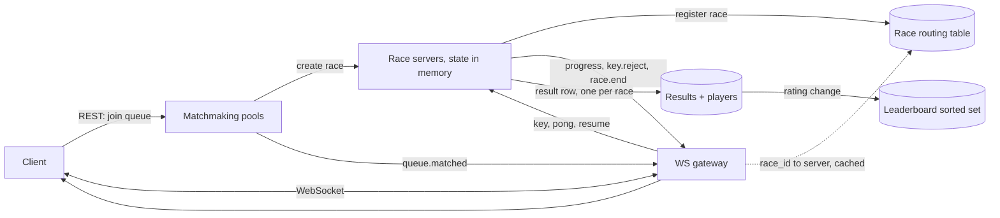

# Typing Race Game

[English](README.md) · [中文](README.zh.md)

<!-- meta:begin -->
| Type | Priority | Difficulty | Roles | Topics | Round |
| --- | --- | --- | --- | --- | --- |
| System design | ★☆☆☆☆ | Medium | SWE | real-time, websocket, matchmaking, leaderboard, latency | Phone screen |
<!-- meta:end -->

## Problem

Design the real-time backend for an online typing race. A *race* is a contest between 2 and 8 players.
Every player in a race is given the same *passage*, a string of $L$ characters (letters, digits, spaces
and punctuation, no line breaks). All players start at one common instant, the *go time*, and type the
passage one character at a time, left to right. A *keystroke* is one typed character. There is no
backspace.

Each player has a *cursor*: the number of passage characters the player has typed correctly so far, 0 at
the go time. A keystroke is processed as follows.

- If the player is in a *cooldown* (defined next), the keystroke is *discarded*: it does not move the
  cursor, is not queued for later, and does not extend the cooldown.
- Otherwise, if the typed character equals the passage character at the cursor, the cursor advances by 1.
- Otherwise the keystroke is an *error*: the cursor does not move, and the player enters a cooldown that
  lasts exactly 1 second, counted from the instant of the erroneous keystroke. A keystroke made at exactly
  the end of the cooldown is processed normally.

A player *finishes* when the cursor reaches $L$. The player who finishes first wins; the other finishers
rank after the winner in finishing order, and players who never finish rank after all finishers by
cursor, larger first. Equal finishing instants and equal cursors are broken by smaller player id.

Example, with the passage `go far` ($L = 6$), go time 0 and times in milliseconds. Player A types `g` at
100 (cursor 1), `x` at 300 (error: cooldown until 1300), `o` at 600 (discarded), `o` at 1299
(discarded), `o` at 1300 (cursor 2), then ` ` at 1450, `f` at 1600, `a` at 1750 and `r` at 1900
(cursors 3, 4, 5, 6): A finishes at 1900. Player B types `g`, `o`, ` `, `f`, `a`, `r` at 100, 250, 400,
550, 700, 850 with no error and finishes at 850, so B wins and A ranks second.

Scale this design for:

- 100,000 players are in a race at the same time at peak, and 50,000 more are connected but idle or
  waiting for a match. Races average 4 players, so 25,000 races run concurrently.
- A passage has $L = 250$ characters. A player types 5 to 8 keystrokes per second; use 6 for sizing.
- A race lasts about 60 seconds from the start of the countdown to the results screen, and the number of
  races in progress averages one third of the peak over a day.
- Target match wait time: 95th percentile under 10 seconds.
- Target progress latency, from a keystroke to the opponents' screens showing the new cursor: 95th
  percentile under 300 ms.
- Target winner announcement: within 500 ms of the winning keystroke reaching the server.
- At most 0.01% of races may be lost to a server failure.
- One-way network delays between clients and the service differ by up to 300 ms from player to player,
  and clients' clocks are unsynchronized.

In scope: matchmaking; the race lifecycle from forming a race to storing its result; the cooldown and
the unfreezing of a player; handling duplicated, lost and reordered messages; a rating system with a
global leaderboard; and making the outcome depend on typing rather than on network delay (start-time
synchronization, estimating a client's clock offset, timestamps assigned by the server versus by the
client, and bounds against forged timestamps). Out of scope: choosing or generating passages, accounts
and authentication, chat, spectating, and detection of automated typing beyond those timing bounds.

Produce:

1. Requirements and a scale estimate: the peak keystroke rate, the connection count and the number of
   gateway and race-server instances (state your assumption for what one instance holds), the outbound
   message rate, and the daily storage growth.
2. A data model and the APIs, with REST endpoints and WebSocket messages listed separately.
3. An architecture diagram, and a walk-through of one keystroke from the keyboard to the opponents'
   screens.
4. Deep dives into: the race lifecycle; the cooldown and how a player is unfrozen; matchmaking; message
   ordering and server failure.
5. A leaderboard ranking players by rating: how ratings change after a race, and how to serve the top
   100 and any player's rank.
6. Latency fairness: how the start, the cooldown and the winner decision stay fair for players with
   different network delays, and what stops a client from forging its timestamps.

## Reference solution

<details>
<summary>Show the reference solution</summary>

Worth confirming before designing: whether a race that loses its server may be voided with no rating
change (assumed yes below; the loss budget of 0.01% is what makes this acceptable), and whether
players who disconnect mid-race keep their place and may resume (assumed yes: the race goes on without
them, and they rejoin with their cursor intact).

### Requirements and scale

**Keystrokes.** 100,000 racing players at 6 keystrokes per second send 600,000 keystrokes/s at peak
(an upper bound, since countdown and results time carry none). A keystroke frame is a sequence number,
a character and a client timestamp, about 40 bytes with framing, so inbound traffic is only 24 MB/s;
connection count and per-message CPU are what matter, as in any WebSocket service.

**Outbound.** Echoing every keystroke to the other players of its race would cost 600,000 x 3 = 1.8
million messages/s for 4-player races (7 recipients, so 4.2 million, in an 8-player race). Instead the
race server sends each race one *progress snapshot* every 200 ms with all players' cursors, about
100 bytes: 100,000 players x 5 snapshots/s = 500,000 messages/s, 50 MB/s, independent of race size,
3.6 times fewer than echoing at the average size. The cost is up to 200 ms of added progress latency,
inside the 300 ms target together with the network legs; a typed character itself needs no echo to its
author, whose client displays it at once and is corrected by the next snapshot.

**Fleets.** Connected players are 150,000. Budgeting 10,000 connections per gateway (bounded by messages
per second, about 73,000 per instance, not by memory) needs 15 instances bare, 17 with two spare for
rolling deploys. A race lives entirely in one race server's memory (about 1 KB: 8 player states and a
reference to the passage), so memory does not bound the fleet. The bound is the *blast radius* of a
crash, because a lost server voids its races: budgeting 1,000 races per instance (24,000 keystrokes/s,
well under one core) needs 25 instances bare, 27 with margin.

**Races and queue.** 25,000 concurrent races of 60 s start at 417 races/s at peak, so 1,667 players/s join
the queue; with a mean wait of 4 s, Little's law (number in the system = arrival rate x time in the
system) gives about 6,700 waiting entries at once, tiny. Averaged over a day there are 8,333 concurrent
races, 139 starts/s, 12 million races/day.

**Storage.** A finished race is one row of about 60 bytes plus about 40 bytes per player (rank, finishing
time, final cursor, errors, rating before and change), 220 bytes at 4 players: 12 million x 220 B = 2.6 GB/day,
about 1 TB/year. Keystrokes are never stored; the final cursor and error count are what the race server
accumulates. Peak rating updates are 100,000 / 60 s = 1,667 players/s.

### Data model and API

**Player**: `player_id`, `username`, `rating` (integer, 1500 at sign-up), `region`, `created_at`.

**Passage**: `passage_id`, `text`, `language`, `difficulty`.

**Race** (durable, written at the end): `race_id`, `passage_id`, `go_at_ms`, `status`
(`done`/`voided`), `ended_at`, `server_id`.

**RaceResult**: `race_id`, `player_id`, `rank`, `finish_ms` (relative to the go time, null if the player
did not finish), `final_cursor`, `errors`, `rating_before`, `rating_delta`; unique on
(`race_id`, `player_id`).

Live race state is in memory only: the `Race` object below (per-player cursor, `frozen_until`,
`last_seq`, clock offset, delivery gateway). The matchmaking pool is in memory on its matcher, rebuilt
from clients re-joining if the matcher dies.

REST, for anything not on the typing path:

1. `POST /v1/queue` returns `{ticket_id}`; `DELETE /v1/queue/{ticket_id}` leaves the queue.
2. `GET /v1/races/{race_id}`: the stored result, for the results screen after the race object is gone.
3. `GET /v1/leaderboard?limit=100`: the top players. `GET /v1/players/{player_id}/rank`: a player's
   rating and rank.

WebSocket, for everything inside a race:

- Client to server: `hello {race_id, token}`, `pong {ping_id, client_ms}`,
  `key {seq, ch, client_ms}`, `resume {race_id, last_acked_seq}`.
- Server to client: `queue.matched {race_id}`, `ping {ping_id}`, `race.start {passage, go_at_ms,
  players}` (`go_at_ms` in server time), `key.reject {seq, cursor, frozen_until_ms}`,
  `progress {server_ms, cursors, acked_seq, frozen_until_ms}`, `race.winner {player_id}`,
  `race.end {ranking, rating_deltas}`.

### Architecture



Walk-through of one keystroke: the client shows the character and moves its own cursor at once (if it
matches the passage it holds), then sends `key {seq, ch, client_ms}`. The gateway looks up the race's
server in its cached routing table and forwards the frame without interpreting it. The race server
stamps the arrival time, converts `client_ms` into server time (clock section), and runs the handler
below: it discards a duplicate or out-of-order `seq`, discards the keystroke inside a cooldown, advances
the cursor or starts a cooldown, and notes a finish. Only an error produces an immediate reply
(`key.reject`, to the typist alone). Every 200 ms the server sends one `progress` snapshot per race to
all its players, which carries each typist's authoritative cursor and `acked_seq`, so the client drops
unacknowledged keystrokes it already knows are settled and corrects any mismatch.

### Deep dives

**Race lifecycle.** A race is created by the matchmaker choosing the least-loaded race server and
calling `create_race(race_id, passage_id, players)`; the server registers `race_id` in the routing
table and the matchmaker sends `queue.matched` to the players. States:

1. `LOADING`: players connect, send `hello`, and the server runs clock-offset pings with each of them. It
   waits up to 5 s; players who have not shown up are removed and, if fewer than 2 remain, the race is
   voided and the others re-enter the queue at the front.
2. `COUNTDOWN`: the server fixes `go_at = now + 3000 ms` (server time), sends `race.start` carrying the
   passage text and `go_at` to everyone. The 3 s exceeds the largest one-way delay in the requirements.
3. `RUNNING`: keystrokes with an adjusted time before `go_at` are discarded (a false start gets nothing).
4. `SETTLING`, entered when the first finishing keystroke arrives: after a 200 ms grace period
   (derived below) the winner is announced; the race ends when everyone has finished, 10 s after the first
   finish, or 120 s after the go time, whichever comes first. Players who have not finished are ranked
   by cursor.
5. `DONE`: the server computes rating changes, writes the result rows and the ratings in one
   transaction, sends `race.end`, and frees the state after a short linger so that a late `resume` can
   still receive the ending. Writing before announcing means an announced result is a stored result.

A disconnected player is not removed from `RUNNING`: the cursor stays and the race goes on. On
reconnection the client sends `resume {race_id, last_acked_seq}`, the gateway re-routes through the
table, and the server replies with a `progress` snapshot and the passage; the client resends keystrokes
numbered above `acked_seq` (their timestamps are still the original ones).

**Cooldown and unfreezing.** The cooldown must be decided on the server: a client-side cooldown is
bypassed by editing the client, and keeping the cooldown in a database would turn
600,000 keystrokes/s into 600,000 reads/s of a value that changes only on an error. The state is three
integers per player in the race server's memory (cursor, `frozen_until`, `last_seq`). There is no timer
and no unfreeze event: a player is frozen exactly when a keystroke's time is less than `frozen_until`,
so "unfreezing" is the comparison itself, evaluated lazily on the next keystroke (and when building a
snapshot, to show a frozen indicator). Timers per player would add 100,000 timer objects and a race
between a timer and a keystroke for nothing.

Inputs during the cooldown are discarded and not answered one by one, because a frozen player pressing
keys at 8/s would otherwise draw 8 replies/s. The sender is told once, with `frozen_until_ms` on the
`key.reject` that started the cooldown, and in every `progress` snapshot. The client predicts the same
cooldown locally (it knows the passage, so it can tell an error at once), greys out its input until
`frozen_until_ms` converted to its own clock, and overwrites its prediction with the server's figures
when they differ. Discarded keystrokes still consume their sequence numbers, so a retransmission after a
reconnect cannot revive them.

Messages can be duplicated (client retransmission after a reconnect), lost or arrive out of order. Over
one TCP connection frames arrive in order, so the realistic cases are duplicates and a gap after a
reconnect. Each keystroke carries a per-player `seq` starting at 1, and the server keeps `last_seq`: a
`seq` at most `last_seq` is a duplicate and is ignored, a `seq` above `last_seq + 1` means a hole, which
is answered with the expected number so the client resends from there (the server never skips ahead,
since a cursor depends on every earlier keystroke), and `seq == last_seq + 1` is processed.

```python
COOLDOWN_MS = 1000
GRACE_MS = 200          # also MAX_LAG_MS: the largest latency credit a keystroke may receive
MAX_LAG_MS = GRACE_MS


class PlayerState:
    def __init__(self):
        self.cursor = 0
        self.frozen_until = 0       # server time; a keystroke is discarded while its time < frozen_until
        self.last_seq = 0
        self.finished_at = None     # adjusted server time of the finishing keystroke
        self.errors = 0


class Race:
    def __init__(self, passage, player_ids, go_ms):
        self.passage = passage
        self.go_ms = go_ms
        self.players = {pid: PlayerState() for pid in player_ids}
        self.first_finish_recv = None   # server arrival time of the first finishing keystroke

    def keystroke(self, pid, seq, ch, s_ms, t_recv_ms):
        """s_ms: the keystroke's time on the server clock after adjustment; t_recv_ms: its arrival time."""
        p = self.players[pid]
        if seq <= p.last_seq:
            return "duplicate"          # retransmission: already processed, ignore it
        if seq != p.last_seq + 1:
            return "gap"                # the client must resend from last_seq + 1
        p.last_seq = seq                # warning: advance last_seq for every keystroke, including discarded ones
        if p.finished_at is not None or s_ms < self.go_ms:
            return "ignored"            # already finished, or a false start
        if s_ms < p.frozen_until:       # warning: strict <, so a keystroke exactly at frozen_until is accepted
            return "cooldown"           # warning: a discarded keystroke must not extend frozen_until
        if ch != self.passage[p.cursor]:
            p.errors += 1
            p.frozen_until = s_ms + COOLDOWN_MS   # warning: counted from the keystroke's time, not from the reply
            return "error"
        p.cursor += 1
        if p.cursor == len(self.passage):
            p.finished_at = s_ms
            if self.first_finish_recv is None:
                self.first_finish_recv = t_recv_ms
            return "finish"
        return "ok"

    def winner(self, now_ms):
        """None until the grace period after the first finishing keystroke has passed."""
        if self.first_finish_recv is None or now_ms < self.first_finish_recv + GRACE_MS:
            return None
        done = [(p.finished_at, pid) for pid, p in self.players.items() if p.finished_at is not None]
        return min(done)[1]

    def ranking(self):
        fin = sorted((p.finished_at, pid) for pid, p in self.players.items() if p.finished_at is not None)
        rest = sorted((-p.cursor, pid) for pid, p in self.players.items() if p.finished_at is None)
        return [pid for _, pid in fin] + [pid for _, pid in rest]
```

**Matchmaking.** One pool holds the waiting players of one region and language, as a list sorted by
rating. A pool is owned by one single-threaded matcher that runs a tick every 100 ms, so a player can
never be given to two races and no lock exists. Load is small (1,667 joins/s over all pools, 6,700
entries), so pools are split for failure isolation, not for throughput.

A race has 2 to 8 players, so the rule must decide both who and when. The window grows with waiting
time: Delta(w) = min(50 + 50 per second waited, 500) rating points, reaching the cap after 9 s.
The longest-waiting player is the *seed*. A waiting player is a candidate for the seed if each is inside
the other's window, which with the window growing in time means the distance is at most the candidate's
own window (the younger entry has the smaller window). The seed takes the 7 closest candidates by rating
distance. The race starts at once if 8 players are found; otherwise only when the seed has waited 5 s
and at least 2 players are found, so a busy pool produces full races and a quiet pool produces small
ones, never an unbounded wait. Rating-bucket pools with an overlapping search would also work, but a
sorted structure answers "everyone within Delta of r" with a range query and nothing to tune.

```python
import bisect

DELTA0, DELTA_RATE_PER_S, DELTA_MAX = 50, 50, 500
FILL_MS, MAX_PLAYERS = 5000, 8


def window(wait_ms):
    return min(DELTA0 + DELTA_RATE_PER_S * wait_ms // 1000, DELTA_MAX)


class Pool:
    def __init__(self):
        self.entries = []               # sorted list of (rating, player_id, joined_ms)

    def add(self, rating, pid, joined_ms):
        bisect.insort(self.entries, (rating, pid, joined_ms))

    def try_form(self, seed, now_ms):
        rating, _, joined = seed
        w = window(now_ms - joined)
        lo = bisect.bisect_left(self.entries, (rating - w,))
        hi = bisect.bisect_right(self.entries, (rating + w, float("inf")))
        cands = [e for e in self.entries[lo:hi]
                 if e != seed and abs(e[0] - rating) <= window(now_ms - e[2])]
        cands.sort(key=lambda e: (abs(e[0] - rating), e[1]))
        group = [seed] + cands[:MAX_PLAYERS - 1]
        if len(group) == MAX_PLAYERS or (now_ms - joined >= FILL_MS and len(group) >= 2):
            for e in group:
                self.entries.remove(e)  # warning: O(n); a skip list or a Redis sorted set removes in O(log n)
            return [e[1] for e in group]
        return None

    def tick(self, now_ms):
        races, taken = [], set()
        for seed in sorted(self.entries, key=lambda e: (e[2], e[1])):   # oldest first
            if seed[1] in taken:
                continue                # warning: a seed already placed in a race earlier in this tick
            group = self.try_form(seed, now_ms)
            if group:
                taken.update(group)
                races.append(group)
        return races
```

After a seed fails to form a race, the tick tries the next-oldest entry, so one hard-to-place player does
not block the rest of the pool.

**Message ordering and server failure.** One race lives wholly on one server, with no lease or
takeover, so there is never a second owner to fence. The price is that a crash voids the races on that
server. The estimate: with instance failures about once per 30 days, a race of 60 s is lost with
probability 60 / (30 x 86,400) = 0.0023%, under the 0.01% budget, about 280 of the 12 million daily
races. A voided race changes no ratings and its players are re-queued at the front.

The alternative is to replicate: snapshot every race's cursors, `frozen_until`, `last_seq` once a second
to a shared store (25,000 writes/s, about 5 MB/s), and have a standby take over from the snapshot, with
clients resending keystrokes above their `acked_seq`. It shrinks losses further, but detecting the
failure takes seconds during which nobody can type, which is itself unfair, so the race would need to be
paused and the go time restarted; the cost is a second code path and constant write load to rescue about
0.002% of races, so it is not done here. It becomes worth it where a single race is valuable (a
tournament final), with replication limited to those races.

Gateway loss is cheaper: its sockets reconnect with jitter and `resume`, and the race goes on meanwhile.
A race server's registry entry is deleted when the race is done, so a stale cached route is answered with
`not_found` and the gateway refreshes it.

**Leaderboard.** Players are ranked by `rating`. After a race the server computes each player's change
from the ratings taken when the race was formed (stored in `RaceResult.rating_before`, so the change is
a function of the race alone). Each pair of players counts as a duel won by whoever ranks higher, with
the standard Elo expectation; a player's change is the average over the n - 1 duels times K, so an
8-player race moves a rating no more than a single duel, and changes in one race sum to zero.

```python
def rating_deltas(ratings, order, k=32):
    """ratings: player id -> rating before; order: player ids, best rank first. Returns id -> change."""
    n = len(order)
    pos = {pid: i for i, pid in enumerate(order)}
    out = {}
    for i in order:
        total = 0.0
        for j in order:
            if i == j:
                continue
            expected = 1 / (1 + 10 ** ((ratings[j] - ratings[i]) / 400))
            total += (1.0 if pos[i] < pos[j] else 0.0) - expected
        out[i] = k * total / (n - 1)    # warning: dividing by n - 1 keeps an 8-player race as volatile as a duel
    return out
```

The durable rating lives in `Player.rating`; the leaderboard is a derived Redis sorted set with the
player id as member and the rating as score. The result transaction does
`INSERT RaceResult ... ON CONFLICT DO NOTHING` and adds `rating_delta` to `Player.rating` only for rows
actually inserted, so a retry after a crash cannot apply a change twice, and then `ZADD` the new rating
(the sorted set is rebuilt from the table if lost, so it needs no persistence of its own).
Top 100 is `ZREVRANGE 0 99 WITHSCORES`, cached for 1 s. A player's rank is 1 + the number of players with
a strictly higher rating (`ZCOUNT` over the open interval above the rating), so equal ratings share a
rank. Load is 1,667 `ZADD`/s, and 20 million rated players at about 100 bytes each are 2 GB, so one node
suffices; beyond that, shard by rating band (a player's rank is the counts of higher bands plus the
local count). A weekly board is the same structure under a key per week, expired by TTL. A player is in
at most one race at a time (the matcher removes a player from the pool when forming a race, and a race
registers its players), so two races never update one rating at once.

**Latency fairness.** Three designs for time-stamping a keystroke:

1. *Server arrival time.* Cannot be forged and needs no clocks, but it charges each player their own
   one-way delay: with delays differing by up to 300 ms, one player is 1.8 characters (300 ms x
   6/s) behind the other, and a cooldown ends later for the slower connection. Races are often decided by
   less than that.
2. *Client timestamps, trusted.* Removes the delay but a modified client can claim any time.
3. *Client timestamps converted to the server clock and clamped to the arrival time.* Used here.

*Clock offset.* The server pings each client during `LOADING` (5 pings 100 ms apart) and every 5 s
afterwards: it sends `ping {id}` at server time a, the client answers at once with `pong {id, c}` where
c is its monotonic clock reading, and the server receives it at b. The round trip is b - a; assuming the
two directions take equal time, the client read its clock at server time a + (b - a)/2, so
offset = a + (b - a)/2 - c and server_time = client_time + offset. The error is at most half the
round trip (the whole round trip in one direction in the worst case), so the best of the last 8 samples,
the one with the smallest round trip, is kept. The client clock must be monotonic, not wall-clock, so
that a clock adjustment cannot shift it.

*Clamping.* A keystroke with `client_ms` c, offset o and arrival time t is stamped
s = min(max(c + o, t - MAX_LAG), t), then raised to the player's previous stamp if lower. The upper
bound says a keystroke cannot come from the future; the lower bound caps the latency credit at
MAX_LAG = 200 ms (about the 95th percentile one-way delay), so a client lying about its clock gains at
most 200 ms in its finishing time, and at most 200 ms per cooldown, however far it lies. Delay beyond
200 ms is not credited. The stamp is used for everything in the handler above: the cooldown start
and end, the false-start test and the finishing time, so cooldown length is 1 s of the player's own time
rather than 1 s minus a delay. Further plausibility bounds: stamps never decrease, keystrokes closer than
25 ms or a sustained rate above 20 per second flag the player (no human types that), and `pong`
samples whose offset jumps more than 100 ms from the previous estimate are discarded.

```python
def offset_from_ping(a_ms, b_ms, c_ms):
    """Server sent the ping at a, got the pong at b; the client read its clock as c in between."""
    rtt = b_ms - a_ms
    return a_ms + rtt / 2 - c_ms, rtt


def to_server_time(c_ms, offset, t_recv_ms, prev_stamp):
    s = c_ms + offset
    s = min(s, t_recv_ms)                 # cannot come from the future
    s = max(s, t_recv_ms - MAX_LAG_MS)    # warning: the credit cap is the whole defence against a forged clock
    return max(s, prev_stamp)             # stamps never go backwards
```

*Start.* `go_at` is a server time; the client converts it to its own clock with its offset and counts
down locally, so all players see the start within their offset error of one another (at most half their
round trip, tens of milliseconds), rather than whenever the packet happened to arrive. A keystroke whose
stamp is before `go_at` is discarded.

*Winner.* The winner is the smallest finishing stamp, not the first arrival. Let the first finishing
keystroke arrive at t with stamp s, so s <= t. Another finishing keystroke with stamp s' and arrival t'
satisfies t' <= s' + MAX_LAG by the clamp. If it beats the first one, s' <= s, hence
t' <= s + MAX_LAG <= t + MAX_LAG. So every finisher that can beat the first arrival arrives within
200 ms of it, and waiting GRACE = 200 ms after the first finishing arrival makes the decision final,
at the price of 200 ms added to the announcement (within the 500 ms target).

### Follow-ups

- Offer a practice race against a recorded run when a pool stays empty for 30 s.
- Replace the 1-second cooldown by an escalating one (1 s, then 2 s on a second consecutive error) and
  note what the false-start and plausibility bounds need to change.
- Rank by a seasonal best words-per-minute figure instead of an Elo rating, and say how that changes the
  leaderboard writes (a max, not an increment).
- Support 10,000-player events: the progress snapshot grows with race size, so send only the nearest
  neighbours' cursors and a coarse overall position.

<details>
<summary>Estimate and logic check (runnable)</summary>

```python
import math
import random

# ---------- scale ----------
racing_players = 100_000
connected = racing_players + 50_000
mean_race_size = 4
concurrent_races = racing_players // mean_race_size
assert concurrent_races == 25_000

L, keys_per_s = 250, 6
assert round(L / keys_per_s) == 42                       # seconds of typing in a 60 s race

keystrokes_per_s = racing_players * keys_per_s
assert keystrokes_per_s == 600_000
key_frame_bytes = 40
assert keystrokes_per_s * key_frame_bytes / 1e6 == 24.0  # MB/s inbound

echo_msgs = keystrokes_per_s * (mean_race_size - 1)
assert echo_msgs == 1_800_000
assert keystrokes_per_s * 7 == 4_200_000                 # 8-player races
snapshot_interval_s = 0.2
snapshots_per_s = racing_players / snapshot_interval_s
assert snapshots_per_s == 500_000                        # 100,000 players x 5 per second
snapshot_bytes = 100
assert snapshots_per_s * snapshot_bytes / 1e6 == 50.0
assert round(echo_msgs / snapshots_per_s, 1) == 3.6

conns_per_gateway = 10_000
gateways_bare = math.ceil(connected / conns_per_gateway)
assert gateways_bare == 15 and gateways_bare + 2 == 17
assert round((keystrokes_per_s + snapshots_per_s) / gateways_bare) == 73_333

races_per_server = 1_000
servers_bare = math.ceil(concurrent_races / races_per_server)
assert servers_bare == 25 and servers_bare + 2 == 27
assert races_per_server * mean_race_size * keys_per_s == 24_000

race_s = 60
starts_per_s = concurrent_races / race_s
assert round(starts_per_s) == 417
joins_per_s = starts_per_s * mean_race_size
assert round(joins_per_s) == 1_667
mean_wait_s = 4
assert round(joins_per_s * mean_wait_s, -2) == 6_700     # Little's law
avg_races = concurrent_races / 3
assert round(avg_races) == 8_333
races_per_day = avg_races / race_s * 86_400
assert round(races_per_day) == 12_000_000

row_bytes = 60 + 40 * mean_race_size
assert row_bytes == 220
assert round(races_per_day * row_bytes / 1e9, 1) == 2.6
assert round(races_per_day * row_bytes * 365 / 1e12, 2) == 0.96
assert round(racing_players / race_s) == 1_667           # rating updates per second

# ---------- failure ----------
mtbf_s = 30 * 86_400
p_lost = race_s / mtbf_s
assert round(p_lost * 100, 4) == 0.0023 and p_lost < 1e-4
assert round(races_per_day * p_lost) == 278
snapshot_writes = concurrent_races * 1
assert snapshot_writes == 25_000
assert snapshot_writes * 200 / 1e6 == 5.0                # MB/s at 200 bytes

# ---------- leaderboard memory ----------
assert 20_000_000 * 100 / 1e9 == 2.0

# ---------- latency ----------
assert round(0.300 * keys_per_s, 1) == 1.8
assert (DELTA_MAX - DELTA0) / DELTA_RATE_PER_S == 9      # seconds to the cap

# ---------- the statement's example ----------
race = Race("go far", ["A", "B"], go_ms=0)
a_events = [(100, "g"), (300, "x"), (600, "o"), (1299, "o"), (1300, "o"),
            (1450, " "), (1600, "f"), (1750, "a"), (1900, "r")]
a_status = [race.keystroke("A", i + 1, ch, t, t) for i, (t, ch) in enumerate(a_events)]
assert a_status == ["ok", "error", "cooldown", "cooldown", "ok", "ok", "ok", "ok", "finish"]
assert race.players["A"].cursor == 6 and race.players["A"].finished_at == 1900
for i, (t, ch) in enumerate([(100, "g"), (250, "o"), (400, " "), (550, "f"), (700, "a"), (850, "r")]):
    race.keystroke("B", i + 1, ch, t, t)
assert race.players["B"].finished_at == 850
assert race.winner(1899 + GRACE_MS) is None              # A's finish arrived at 1900, B's at 850
assert race.winner(10_000) == "B" and race.ranking() == ["B", "A"]
assert race.keystroke("A", 9, "r", 2000, 2000) == "duplicate"
assert race.keystroke("A", 11, "r", 2000, 2000) == "gap"

# ping example: a=5000, c=1020, b=5060 gives rtt 60 and offset 4010 (true offset in [3980, 4040])
assert offset_from_ping(5000, 5060, 1020) == (4010.0, 60)
assert to_server_time(1000, 4010, 5100, 0) == 5010
assert to_server_time(1000, 4010, 5400, 0) == 5200       # credit capped at 200 ms
assert to_server_time(1000, 4010, 5000, 0) == 5000       # cannot be in the future
assert to_server_time(1000, 4010, 5100, 5050) == 5050    # never before the previous stamp

# ---------- rating: zero-sum, order-sensitive ----------
rs = {"p1": 1500, "p2": 1600, "p3": 1400, "p4": 1500}
d = rating_deltas(rs, ["p3", "p1", "p4", "p2"])
assert abs(sum(d.values())) < 1e-9
assert d["p3"] > d["p1"] > d["p4"] > d["p2"]
d2 = rating_deltas({"x": 1500, "y": 1500}, ["x", "y"])
assert abs(d2["x"] - 16) < 1e-9 and abs(d2["y"] + 16) < 1e-9


# ---------- brute force 1: the cooldown rule, written as a spec ----------
def brute_player(passage, events, go):
    """events: [(seq, ch, stamp)] in arrival order, possibly with duplicates. Returns (cursor, finish, errors)."""
    seen, ordered = set(), []
    for seq, ch, s in events:
        if seq not in seen:
            seen.add(seq)
            ordered.append((seq, ch, s))
    ordered.sort()
    cursor, last_error, errors, finish = 0, None, 0, None
    for _, ch, s in ordered:
        if finish is not None or s < go:
            continue
        if last_error is not None and s - last_error < COOLDOWN_MS:
            continue
        if ch == passage[cursor]:
            cursor += 1
            if cursor == len(passage):
                finish = s
        else:
            last_error, errors = s, errors + 1
    return cursor, finish, errors


rng = random.Random(7)
for trial in range(400):
    passage = "".join(rng.choice("ab cd") for _ in range(rng.randint(3, 40)))
    pids = list(range(rng.randint(2, 8)))
    go = rng.randint(0, 500)
    streams = {}
    for pid in pids:
        t, evs, cur = go - rng.randint(0, 150), [], 0
        for seq in range(1, rng.randint(1, 80) + 1):
            t += rng.randint(30, 300) if rng.random() < 0.9 else rng.randint(300, 1200)
            if cur < len(passage) and rng.random() < 0.8:
                ch = passage[min(cur, len(passage) - 1)]
            else:
                ch = rng.choice("abcd ")
            evs.append((seq, ch, t))
            cur += 1
        streams[pid] = evs
    # arrival order: random interleaving that keeps each player's order, plus duplicates of earlier frames
    queues = {pid: list(evs) for pid, evs in streams.items()}
    arrivals, sent = [], {pid: [] for pid in pids}
    while any(queues.values()):
        pid = rng.choice([q for q in pids if queues[q]])
        if sent[pid] and rng.random() < 0.15:
            arrivals.append((pid, rng.choice(sent[pid])))        # a retransmission
        ev = queues[pid].pop(0)
        sent[pid].append(ev)
        arrivals.append((pid, ev))
    race = Race(passage, pids, go)
    for pid, (seq, ch, s) in arrivals:
        race.keystroke(pid, seq, ch, s, s)
    per_player = {pid: [e for q, e in arrivals if q == pid] for pid in pids}
    for pid in pids:
        got = (race.players[pid].cursor, race.players[pid].finished_at, race.players[pid].errors)
        assert got == brute_player(passage, per_player[pid], go), (trial, pid)
    fin = sorted((p.finished_at, pid) for pid, p in race.players.items() if p.finished_at is not None)
    if fin:
        assert race.winner(10**9) == fin[0][1]
    else:
        assert race.winner(10**9) is None


# ---------- brute force 2: with honest clocks and delay <= 200 ms, the stamped winner is the true winner ----------
for trial in range(400):
    n = rng.randint(2, 8)
    true_finish = {pid: rng.randint(0, 600) for pid in range(n)}
    delay = {pid: rng.randint(0, MAX_LAG_MS) for pid in range(n)}
    race = Race("a", list(range(n)), go_ms=0)
    arrive = sorted((true_finish[pid] + delay[pid], pid) for pid in range(n))
    first_arrival = arrive[0][0]
    decided_at = first_arrival + GRACE_MS
    assert race.winner(decided_at) is None
    for t_recv, pid in arrive:
        if t_recv <= decided_at:
            s = to_server_time(true_finish[pid], 0, t_recv, 0)
            assert s == true_finish[pid]
            race.keystroke(pid, 1, "a", s, t_recv)
    assert race.winner(decided_at) == min((true_finish[pid], pid) for pid in range(n))[1]


# ---------- brute force 3: matchmaking against a linear scan ----------
def brute_tick(entries, now):
    remaining = list(entries)
    races = []
    for seed in sorted(entries, key=lambda e: (e[2], e[1])):
        if seed not in remaining:
            continue
        cands = [e for e in remaining if e != seed
                 and abs(e[0] - seed[0]) <= min(window(now - seed[2]), window(now - e[2]))]
        cands.sort(key=lambda e: (abs(e[0] - seed[0]), e[1]))
        group = [seed] + cands[:7]
        if len(group) == 8 or (now - seed[2] >= FILL_MS and len(group) >= 2):
            races.append([e[1] for e in group])
            remaining = [e for e in remaining if e not in group]
    return races


for trial in range(300):
    now = 100_000
    m = rng.randint(1, 60)
    spread = rng.choice([100, 400, 1500])
    ents = [(1500 + rng.randint(-spread, spread), pid, now - rng.randint(0, 14_000)) for pid in range(m)]
    pool = Pool()
    for r, pid, j in ents:
        pool.add(r, pid, j)
    got = pool.tick(now)
    assert got == brute_tick(ents, now), trial
    assert all(2 <= len(g) <= 8 for g in got)
    leftover = {e[1] for e in pool.entries}
    assert leftover.isdisjoint({p for g in got for p in g})

# the widening rule: a lone far-away pair matches only once both windows reach the gap
pool = Pool()
pool.add(1500, 1, 0)
pool.add(1900, 2, 0)
assert pool.tick(5_000) == []          # window 300 at 5 s: the gap is 400
assert pool.tick(8_000) == [[1, 2]]    # window 400 at 7 s or later, and the 5 s fill time has passed

print("all checks passed")
```

</details>

</details>
