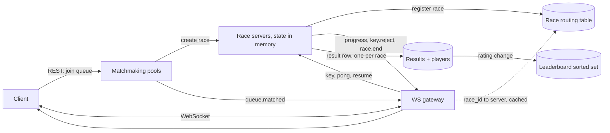

# 打字竞速游戏

[English](README.md) · [中文](README.zh.md)

<!-- meta:begin -->
| 题型 | 优先级 | 难度 | 岗位 | 考点 | 轮次 |
| --- | --- | --- | --- | --- | --- |
| 系统设计 | ★☆☆☆☆ | 中等 | SWE | real-time, websocket, matchmaking, leaderboard, latency | 电话面 |
<!-- meta:end -->

## 题目

设计一个在线打字竞速游戏的实时后端。一场*比赛*（race）有 2 到 8 名玩家。同一场比赛里的每名玩家拿到同一段*文章*（passage），即一个长为 $L$ 个字符的字符串（字母、数字、空格和标点，不含换行）。所有玩家在同一个时刻——*开赛时刻*（go time）——开始，从左到右逐个字符地输入这段文章。一次*按键*（keystroke）就是输入一个字符，没有退格键。

每名玩家有一个*光标*（cursor）：到目前为止已正确输入的文章字符数，开赛时刻为 0。一次按键按如下方式处理。

- 如果玩家正处于*冷却*（cooldown，下面定义）中，这次按键被*丢弃*：它不推进光标，不排队等待以后处理，也不延长冷却。
- 否则，如果输入的字符等于文章中光标所在位置的字符，光标前进 1。
- 否则这次按键是*错误*：光标不动，玩家进入一次恰好持续 1 秒的冷却，从出错按键的时刻起算。恰好在冷却结束那一刻的按键按正常方式处理。

光标到达 $L$ 时玩家*完成*（finish）。最先完成的玩家获胜；其余完成者按完成先后排在获胜者之后，没有完成的玩家排在所有完成者之后，按光标从大到小排列。完成时刻相同或光标相同时，玩家编号小者在前。

例：文章为 `go far`（$`L = 6`$），开赛时刻为 0，时间单位为毫秒。玩家 A 在 100 输入 `g`（光标 1），在 300 输入 `x`（错误：冷却到 1300），在 600 输入 `o`（丢弃），在 1299 输入 `o`（丢弃），在 1300 输入 `o`（光标 2），随后在 1450 输入空格、1600 输入 `f`、1750 输入 `a`、1900 输入 `r`（光标依次为 3、4、5、6）：A 在 1900 完成。玩家 B 在 100、250、400、550、700、850 依次输入 `g`、`o`、空格、`f`、`a`、`r`，无错误，在 850 完成，所以 B 获胜，A 排第二。

按以下规模设计：

- 高峰时有 100,000 名玩家同时在比赛中，另有 50,000 人已连接但空闲或在等待匹配。每场比赛平均 4 人，所以同时进行 25,000 场比赛。
- 一段文章有 $L = 250$ 个字符。玩家每秒按 5 到 8 次键；估算时取 6。
- 一场比赛从倒计时开始到结果页约 60 秒；一天之内进行中的比赛数平均为峰值的三分之一。
- 匹配等待时间目标：第 95 百分位低于 10 秒。
- 进度延迟目标，即从一次按键到对手屏幕上显示新光标：第 95 百分位低于 300 毫秒。
- 获胜者公布目标：从获胜的那次按键到达服务器起算 500 毫秒以内。
- 因服务器故障而丢失的比赛至多占 0.01%。
- 各玩家与服务之间的单向网络延迟相差可达 300 毫秒，各客户端的时钟互不同步。

范围内：匹配；从组建比赛到存储结果的比赛生命周期；冷却以及玩家的解冻；处理重复、丢失和乱序的消息；带全球排行榜的等级分系统；让结果取决于打字而不是网络延迟（开赛时刻同步、估计客户端的时钟偏移、由服务器与由客户端各自给时间戳的取舍，以及防止伪造时间戳的界限）。范围外：选择或生成文章、账号与认证、聊天、观战，以及这些时间界限之外的自动化打字检测。

产出：

1. 需求与规模估算：按键速率峰值、连接数、网关与比赛服务器的实例数（写明你假设一台实例承载多少）、出站消息速率，以及每日存储增长。
2. 数据模型和 API，REST 端点与 WebSocket 消息分开列出。
3. 架构图，以及一次按键从键盘到对手屏幕的完整路径。
4. 深入话题：比赛生命周期；冷却与玩家如何解冻；匹配；消息顺序与服务器故障。
5. 按等级分排名的排行榜：一场比赛之后等级分如何变化，以及如何提供前 100 名和任意玩家的名次。
6. 延迟公平性：开赛、冷却和获胜判定如何在网络延迟不同的玩家之间保持公平，以及什么能阻止客户端伪造时间戳。

## 参考解答

<details>
<summary>展开参考解答</summary>

动手设计之前值得先确认：服务器故障的比赛是否可以作废、不改等级分（下面假设可以；0.01% 的损失预算正是它可接受的原因），以及比赛中途掉线的玩家是否保留位置并可以恢复（假设是：比赛继续进行，他们重连后光标不变）。

### 需求与规模

**按键。** 100,000 名正在比赛的玩家每人每秒 6 次按键，峰值是 600,000 次按键/秒（这是上界，因为倒计时和结果页时间里没有按键）。一帧按键由序号、字符和客户端时间戳组成，连同帧头约 40 字节，所以入站流量只有 24 MB/秒；和任何 WebSocket 服务一样，起决定作用的是连接数和每条消息的 CPU 开销。

**出站。** 把每次按键都回显给同场其他玩家，在 4 人比赛里是 600,000 x 3 = 180 万条消息/秒（8 人比赛有 7 个接收者，即 420 万条）。改为由比赛服务器每 200 毫秒给每场比赛发一次*进度快照*（progress snapshot），包含所有玩家的光标，约 100 字节：100,000 名玩家 x 每秒 5 次快照 = 500,000 条消息/秒，50 MB/秒，与比赛人数无关，比按平均人数回显少 3.6 倍。代价是进度延迟最多多出 200 毫秒，与网络上的两段传输加起来仍在 300 毫秒目标之内；打字者自己看到的字符不需要回显，客户端立即显示，由下一个快照纠正。

**服务层规模。** 已连接玩家 150,000 人。按每台网关 10,000 条连接预算（受限于每秒消息数，每台约 73,000 条，而不是内存），裸需 15 台，加两台滚动发布余量共 17 台。一场比赛整个住在一台比赛服务器的内存里（约 1 KB：8 个玩家状态和一个文章引用），所以内存不限制规模。限制来自一次崩溃的*爆炸半径*（blast radius），因为服务器丢了，它的比赛就作废：按每台实例 1,000 场比赛预算（24,000 次按键/秒，远不到一个核），裸需 25 台，加余量共 27 台。

**比赛与队列。** 25,000 场、每场 60 秒的并发比赛，峰值时每秒开始 417 场，所以每秒有 1,667 名玩家加入队列；平均等待 4 秒，按利特尔法则（Little's law：系统中的数量 = 到达率 x 停留时间），同一时刻约有 6,700 个等待条目，很小。按一天平均，同时有 8,333 场比赛在进行，每秒开始 139 场，每天 1,200 万场。

**存储。** 一场结束的比赛是一行约 60 字节，加每名玩家约 40 字节（名次、完成时间、最终光标、错误数、赛前等级分和变化），4 人时为 220 字节：1,200 万 x 220 B = 2.6 GB/天，约 1 TB/年。按键从不入库；比赛服务器累计的是最终光标和错误数。等级分更新的峰值是 100,000 / 60 秒 = 1,667 名玩家/秒。

### 数据模型与 API

**Player（玩家）**：`player_id`、`username`、`rating`（整数，注册时 1500）、`region`、`created_at`。

**Passage（文章）**：`passage_id`、`text`、`language`、`difficulty`。

**Race（比赛，持久，结束时写入）**：`race_id`、`passage_id`、`go_at_ms`、`status`（`done`/`voided`）、`ended_at`、`server_id`。

**RaceResult（比赛结果）**：`race_id`、`player_id`、`rank`、`finish_ms`（相对开赛时刻，未完成则为空）、`final_cursor`、`errors`、`rating_before`、`rating_delta`；在（`race_id`, `player_id`）上唯一。

进行中的比赛状态只在内存里：下面的 `Race` 对象（每个玩家的光标、`frozen_until`、`last_seq`、时钟偏移、投递用的网关）。匹配池在匹配器的内存里；匹配器宕机时，由客户端重新加入队列来重建。

REST，用于不在打字路径上的一切：

1. `POST /v1/queue` 返回 `{ticket_id}`；`DELETE /v1/queue/{ticket_id}` 离开队列。
2. `GET /v1/races/{race_id}`：已存储的结果，供比赛对象消失之后的结果页使用。
3. `GET /v1/leaderboard?limit=100`：排名靠前的玩家。`GET /v1/players/{player_id}/rank`：某名玩家的等级分和名次。

WebSocket，用于比赛内的一切：

- 客户端 → 服务器：`hello {race_id, token}`、`pong {ping_id, client_ms}`、`key {seq, ch, client_ms}`、`resume {race_id, last_acked_seq}`。
- 服务器 → 客户端：`queue.matched {race_id}`、`ping {ping_id}`、`race.start {passage, go_at_ms, players}`（`go_at_ms` 用服务器时间）、`key.reject {seq, cursor, frozen_until_ms}`、`progress {server_ms, cursors, acked_seq, frozen_until_ms}`、`race.winner {player_id}`、`race.end {ranking, rating_deltas}`。

### 架构



一次按键的完整路径：客户端立即显示这个字符并移动自己的光标（如果与它手上的文章一致），然后发送 `key {seq, ch, client_ms}`。网关在缓存的路由表里查出这场比赛所在的服务器，不解释内容直接转发。比赛服务器给它打上到达时间戳，把 `client_ms` 换算成服务器时间（见时钟一节），然后运行下面的处理函数：丢弃重复或乱序的 `seq`，丢弃冷却中的按键，推进光标或开始冷却，并记录完成。只有错误才会立即产生回复（`key.reject`，只发给打字者本人）。服务器每 200 毫秒给整场比赛的所有玩家发一个 `progress` 快照，其中带有每个打字者的权威光标和 `acked_seq`，客户端据此丢掉已知已落定的未确认按键，并纠正任何不一致。

### 深入话题

**比赛生命周期。** 比赛由匹配器创建：它选负载最轻的比赛服务器，调用 `create_race(race_id, passage_id, players)`；服务器把 `race_id` 登记进路由表，匹配器再向玩家发 `queue.matched`。状态如下：

1. `LOADING`（加载）：玩家连接并发送 `hello`，服务器与每个人进行时钟偏移的 ping。最多等 5 秒；没到的玩家被移除，如果剩下不足 2 人，这场比赛作废，其余玩家排到队首重新入队。
2. `COUNTDOWN`（倒计时）：服务器定下 `go_at = now + 3000 ms`（服务器时间），把带文章文本和 `go_at` 的 `race.start` 发给所有人。3 秒大于需求里最大的单向延迟。
3. `RUNNING`（进行中）：调整后时间早于 `go_at` 的按键被丢弃（抢跑得不到任何东西）。
4. `SETTLING`（结算），第一个完成的按键到达时进入：经过 200 毫秒宽限期（下面推导）后公布获胜者；所有人都完成、第一人完成后满 10 秒、或开赛后满 120 秒，三者先到者结束比赛。未完成的玩家按光标排名。
5. `DONE`（完成）：服务器计算等级分变化，在一个事务里写入结果行和等级分，发送 `race.end`，再停留片刻后释放状态，使迟到的 `resume` 仍能收到结局。先写入后公布，意味着公布出去的结果一定已经存储。

掉线的玩家不会从 `RUNNING` 中移除：光标保留，比赛继续。重连时客户端发送 `resume {race_id, last_acked_seq}`，网关通过路由表重新路由，服务器回复一个 `progress` 快照和文章；客户端重发序号大于 `acked_seq` 的按键（它们的时间戳仍是原来的）。

**冷却与解冻。** 冷却必须由服务器决定：客户端本地的冷却改一改客户端就能绕过，而把冷却放在数据库里，会把每秒 600,000 次按键变成每秒 600,000 次对一个只在出错时才变化的值的读取。状态是比赛服务器内存里每个玩家的三个整数（光标、`frozen_until`、`last_seq`）。没有定时器，也没有解冻事件：玩家被冻结，当且仅当按键的时间小于 `frozen_until`，所以“解冻”就是这个比较本身，在下一次按键时（以及生成快照、展示冻结标记时）惰性求值。给每个玩家配定时器，会凭空多出 100,000 个定时器对象，以及定时器与按键之间的竞争。

冷却期间的输入被丢弃，也不逐条回复，否则一个每秒按 8 次键的冻结玩家会引来每秒 8 条回复。发送者只被告知一次：开始冷却的那条 `key.reject` 里带着 `frozen_until_ms`，之后每个 `progress` 快照里也都带着。客户端在本地预测同样的冷却（它知道文章，所以能立刻判断出错），在 `frozen_until_ms` 换算成自己时钟的时刻之前让输入框变灰，两者不一致时以服务器的数字覆盖预测。被丢弃的按键仍然占用它们的序号，所以重连后的重传无法让它们复活。

消息可能重复（重连后客户端重传）、丢失或乱序。同一条 TCP 连接上的帧是有序到达的，所以现实中的情形是重复，以及重连之后出现的缺口。每次按键带一个每玩家独立、从 1 开始的 `seq`，服务器记着 `last_seq`：`seq` 不大于 `last_seq` 是重复，忽略；`seq` 大于 `last_seq + 1` 表示有缺口，回复期望的序号让客户端从那里重发（服务器绝不跳过，因为光标取决于之前的每一次按键）；`seq == last_seq + 1` 才被处理。

```python
COOLDOWN_MS = 1000
GRACE_MS = 200          # also MAX_LAG_MS: the largest latency credit a keystroke may receive
MAX_LAG_MS = GRACE_MS


class PlayerState:
    def __init__(self):
        self.cursor = 0
        self.frozen_until = 0       # server time; a keystroke is discarded while its time < frozen_until
        self.last_seq = 0
        self.finished_at = None     # adjusted server time of the finishing keystroke
        self.errors = 0


class Race:
    def __init__(self, passage, player_ids, go_ms):
        self.passage = passage
        self.go_ms = go_ms
        self.players = {pid: PlayerState() for pid in player_ids}
        self.first_finish_recv = None   # server arrival time of the first finishing keystroke

    def keystroke(self, pid, seq, ch, s_ms, t_recv_ms):
        """s_ms: the keystroke's time on the server clock after adjustment; t_recv_ms: its arrival time."""
        p = self.players[pid]
        if seq <= p.last_seq:
            return "duplicate"          # retransmission: already processed, ignore it
        if seq != p.last_seq + 1:
            return "gap"                # the client must resend from last_seq + 1
        p.last_seq = seq                # warning: advance last_seq for every keystroke, including discarded ones
        if p.finished_at is not None or s_ms < self.go_ms:
            return "ignored"            # already finished, or a false start
        if s_ms < p.frozen_until:       # warning: strict <, so a keystroke exactly at frozen_until is accepted
            return "cooldown"           # warning: a discarded keystroke must not extend frozen_until
        if ch != self.passage[p.cursor]:
            p.errors += 1
            p.frozen_until = s_ms + COOLDOWN_MS   # warning: counted from the keystroke's time, not from the reply
            return "error"
        p.cursor += 1
        if p.cursor == len(self.passage):
            p.finished_at = s_ms
            if self.first_finish_recv is None:
                self.first_finish_recv = t_recv_ms
            return "finish"
        return "ok"

    def winner(self, now_ms):
        """None until the grace period after the first finishing keystroke has passed."""
        if self.first_finish_recv is None or now_ms < self.first_finish_recv + GRACE_MS:
            return None
        done = [(p.finished_at, pid) for pid, p in self.players.items() if p.finished_at is not None]
        return min(done)[1]

    def ranking(self):
        fin = sorted((p.finished_at, pid) for pid, p in self.players.items() if p.finished_at is not None)
        rest = sorted((-p.cursor, pid) for pid, p in self.players.items() if p.finished_at is None)
        return [pid for _, pid in fin] + [pid for _, pid in rest]
```

**匹配。** 一个池子装着一个地区、一种语言的等待玩家，是一个按等级分排序的列表。一个池子由一个单线程的匹配器独占，每 100 毫秒做一次 tick，所以一个玩家不可能被分进两场比赛，也不需要锁。负载很小（所有池子加起来每秒 1,667 次加入，6,700 个条目），所以拆分池子是为了故障隔离，不是为了吞吐。

一场比赛有 2 到 8 人，所以规则要同时决定“和谁”与“何时”。窗口随等待时间放宽：Delta(w) = min(50 + 每等待一秒加 50, 500) 个等级分，9 秒后到达上限。等待最久的玩家是*种子*（seed）。一名等待者成为种子的候选人，要求双方都在对方的窗口之内；窗口随时间增长，这就等价于距离不超过候选人自己的窗口（后来的条目窗口更小）。种子取等级分距离最近的 7 名候选人。凑够 8 人立即开赛；否则要等种子已等待 5 秒、并且至少找到 2 人才开赛，于是繁忙的池子产出满员比赛，冷清的池子产出小比赛，等待不会无限长。按等级分分桶、搜索重叠桶也可行，但有序结构用一次范围查询就能回答“r 附近 Delta 以内的所有人”，没有要调的参数。

```python
import bisect

DELTA0, DELTA_RATE_PER_S, DELTA_MAX = 50, 50, 500
FILL_MS, MAX_PLAYERS = 5000, 8


def window(wait_ms):
    return min(DELTA0 + DELTA_RATE_PER_S * wait_ms // 1000, DELTA_MAX)


class Pool:
    def __init__(self):
        self.entries = []               # sorted list of (rating, player_id, joined_ms)

    def add(self, rating, pid, joined_ms):
        bisect.insort(self.entries, (rating, pid, joined_ms))

    def try_form(self, seed, now_ms):
        rating, _, joined = seed
        w = window(now_ms - joined)
        lo = bisect.bisect_left(self.entries, (rating - w,))
        hi = bisect.bisect_right(self.entries, (rating + w, float("inf")))
        cands = [e for e in self.entries[lo:hi]
                 if e != seed and abs(e[0] - rating) <= window(now_ms - e[2])]
        cands.sort(key=lambda e: (abs(e[0] - rating), e[1]))
        group = [seed] + cands[:MAX_PLAYERS - 1]
        if len(group) == MAX_PLAYERS or (now_ms - joined >= FILL_MS and len(group) >= 2):
            for e in group:
                self.entries.remove(e)  # warning: O(n); a skip list or a Redis sorted set removes in O(log n)
            return [e[1] for e in group]
        return None

    def tick(self, now_ms):
        races, taken = [], set()
        for seed in sorted(self.entries, key=lambda e: (e[2], e[1])):   # oldest first
            if seed[1] in taken:
                continue                # warning: a seed already placed in a race earlier in this tick
            group = self.try_form(seed, now_ms)
            if group:
                taken.update(group)
                races.append(group)
        return races
```

种子凑不成比赛时，tick 会再试下一个等得最久的条目，所以一个难配的玩家不会堵住池子里的其他人。

**消息顺序与服务器故障。** 一场比赛整个住在一台服务器上，没有租约也没有接管，所以不存在需要隔离的第二个归属者。代价是一次崩溃会让该服务器上的比赛作废。估算：实例大约每 30 天故障一次，一场 60 秒的比赛丢失的概率是 60 / (30 x 86,400) = 0.0023%，低于 0.01% 的预算，每天 1,200 万场里约 280 场。作废的比赛不改等级分，其中的玩家排到队首重新入队。

另一种办法是复制：每秒把每场比赛的光标、`frozen_until`、`last_seq` 快照到共享存储（25,000 次写入/秒，约 5 MB/秒），由备用实例从快照接管，客户端重发序号大于 `acked_seq` 的按键。它能进一步减少损失，但发现故障要几秒，这段时间没人能打字，本身就不公平，所以比赛得暂停并重新定开赛时刻；代价是多一条代码路径和持续的写入负载，只为挽救约 0.002% 的比赛，因此这里不做。当单场比赛很有价值时（锦标赛决赛）才值得做，复制只限这些比赛。

网关丢失的代价更小：它的连接带着抖动重连并 `resume`，比赛期间照常进行。比赛结束时会从注册表里删除这条路由，所以过期的缓存路由得到 `not_found` 回复，网关随即刷新。

**排行榜。** 玩家按 `rating` 排名。一场比赛结束后，服务器按比赛组建时取得的等级分（存在 `RaceResult.rating_before` 里，因此变化量只取决于这场比赛）计算每名玩家的变化。每一对玩家算作一次对决，名次高者获胜，期望值采用标准的 Elo 公式；一名玩家的变化是 n - 1 次对决的平均值乘以 K，所以 8 人比赛对等级分的冲击不超过一次单挑，并且同一场比赛里所有变化之和为零。

```python
def rating_deltas(ratings, order, k=32):
    """ratings: player id -> rating before; order: player ids, best rank first. Returns id -> change."""
    n = len(order)
    pos = {pid: i for i, pid in enumerate(order)}
    out = {}
    for i in order:
        total = 0.0
        for j in order:
            if i == j:
                continue
            expected = 1 / (1 + 10 ** ((ratings[j] - ratings[i]) / 400))
            total += (1.0 if pos[i] < pos[j] else 0.0) - expected
        out[i] = k * total / (n - 1)    # warning: dividing by n - 1 keeps an 8-player race as volatile as a duel
    return out
```

持久的等级分存在 `Player.rating` 里；排行榜是派生的 Redis 有序集合，以玩家编号为成员、等级分为分数。结果事务执行 `INSERT RaceResult ... ON CONFLICT DO NOTHING`，只对真正插入的行把 `rating_delta` 加到 `Player.rating` 上，所以崩溃后的重试不会把变化应用两次，然后 `ZADD` 新的等级分（有序集合丢失时可以从表重建，所以它自己不需要持久化）。前 100 名是 `ZREVRANGE 0 99 WITHSCORES`，缓存 1 秒。一名玩家的名次是 1 加上等级分严格更高的玩家数（用 `ZCOUNT` 数该等级分之上的开区间），所以等级分相同者名次并列。负载是 1,667 次 `ZADD`/秒，2,000 万名有等级分的玩家按每人约 100 字节是 2 GB，一个节点就够；再大就按等级分段分片（一名玩家的名次是更高分段的人数加本段内的计数）。周榜是同样的结构，每周一个键，靠 TTL 过期。一名玩家同一时刻最多在一场比赛里（匹配器组建比赛时把玩家移出池子，比赛又会登记它的玩家），所以两场比赛不会同时更新同一个等级分。

**延迟公平性。** 给按键打时间戳有三种设计：

1. *服务器到达时间。* 无法伪造，也不需要时钟，但它让每名玩家承担自己的单向延迟：延迟相差 300 毫秒时，一方比另一方落后 1.8 个字符（300 毫秒 x 每秒 6 个），冷却对连接慢的一方也结束得更晚。比赛的胜负常常比这个差距还小。
2. *信任客户端时间戳。* 消除了延迟，但被改过的客户端可以声称任何时间。
3. *把客户端时间戳换算到服务器时钟，并用到达时间做上限钳制。* 这里采用。

*时钟偏移。* 服务器在 `LOADING` 期间（间隔 100 毫秒发 5 次 ping）以及之后每 5 秒向客户端发 ping：服务器在服务器时间 a 发送 `ping {id}`，客户端立即回答 `pong {id, c}`，其中 c 是它单调时钟的读数，服务器在 b 收到。往返时间是 b - a；假设两个方向耗时相等，客户端读取时钟的那一刻对应服务器时间 a + (b - a)/2，所以 offset = a + (b - a)/2 - c，server_time = client_time + offset。误差至多是往返时间的一半（最坏情形是整个往返都花在一个方向上），因此在最近 8 个样本里保留往返时间最小的那个。客户端时钟必须用单调时钟，而不是挂钟，这样时钟调整不会让它跳变。

*钳制。* 一次按键的 `client_ms` 为 c，偏移为 o，到达时间为 t，则时间戳是 s = min(max(c + o, t - MAX_LAG), t)，如果比该玩家上一个时间戳还小，就抬到上一个时间戳。上界表示按键不可能来自未来；下界把延迟补偿限制在 MAX_LAG = 200 毫秒（约为单向延迟的第 95 百分位），所以无论客户端把时钟谎报得多离谱，它的完成时间最多占到 200 毫秒的便宜，每次冷却最多占 200 毫秒。超过 200 毫秒的延迟不补偿。上面的处理函数里一切都用这个时间戳：冷却的开始和结束、抢跑判断和完成时间，所以冷却长度是玩家自己时间里的 1 秒，而不是 1 秒减去延迟。其他合理性界限：时间戳永不递减，间隔小于 25 毫秒的按键或持续超过每秒 20 次的速率会标记该玩家（没有人能这样打字），偏移比上一个估计跳变超过 100 毫秒的 `pong` 样本被丢弃。

```python
def offset_from_ping(a_ms, b_ms, c_ms):
    """Server sent the ping at a, got the pong at b; the client read its clock as c in between."""
    rtt = b_ms - a_ms
    return a_ms + rtt / 2 - c_ms, rtt


def to_server_time(c_ms, offset, t_recv_ms, prev_stamp):
    s = c_ms + offset
    s = min(s, t_recv_ms)                 # cannot come from the future
    s = max(s, t_recv_ms - MAX_LAG_MS)    # warning: the credit cap is the whole defence against a forged clock
    return max(s, prev_stamp)             # stamps never go backwards
```

*开赛。* `go_at` 是服务器时间；客户端用自己的偏移把它换算到自己的时钟上，并在本地倒计时，所以所有玩家看到的开赛时刻彼此相差只在各自的偏移误差之内（至多是往返时间的一半，几十毫秒），而不是取决于数据包碰巧何时到达。时间戳早于 `go_at` 的按键被丢弃。

*获胜者。* 获胜者是完成时间戳最小的人，而不是最先到达的人。设第一个完成的按键在 t 到达、时间戳为 s，则 s <= t。另一个完成的按键时间戳为 s'、到达时间为 t'，由钳制得 t' <= s' + MAX_LAG。如果它胜过第一个，则 s' <= s，因而 t' <= s + MAX_LAG <= t + MAX_LAG。所以每一个有可能胜过第一个到达者的完成者，都会在它之后 200 毫秒之内到达；在第一个完成按键到达后等待 GRACE = 200 毫秒，判定就成为最终结果，代价是公布时间多出 200 毫秒（仍在 500 毫秒目标内）。

### 追问

- 某个池子 30 秒内一直没人时，提供和录制成绩对打的练习赛。
- 把 1 秒冷却改成递增冷却（连续第二次出错变 2 秒），并说明抢跑和合理性界限需要怎样调整。
- 改为按赛季最佳每分钟字数（WPM）排名，而不是 Elo 等级分，并说明排行榜的写入会怎样变化（取最大值，而不是增量）。
- 支持 10,000 人的活动：进度快照随比赛人数增长，改为只发最近几名对手的光标和一个粗略的总体位置。

<details>
<summary>估算与逻辑核对（可运行）</summary>

```python
import math
import random

# ---------- scale ----------
racing_players = 100_000
connected = racing_players + 50_000
mean_race_size = 4
concurrent_races = racing_players // mean_race_size
assert concurrent_races == 25_000

L, keys_per_s = 250, 6
assert round(L / keys_per_s) == 42                       # seconds of typing in a 60 s race

keystrokes_per_s = racing_players * keys_per_s
assert keystrokes_per_s == 600_000
key_frame_bytes = 40
assert keystrokes_per_s * key_frame_bytes / 1e6 == 24.0  # MB/s inbound

echo_msgs = keystrokes_per_s * (mean_race_size - 1)
assert echo_msgs == 1_800_000
assert keystrokes_per_s * 7 == 4_200_000                 # 8-player races
snapshot_interval_s = 0.2
snapshots_per_s = racing_players / snapshot_interval_s
assert snapshots_per_s == 500_000                        # 100,000 players x 5 per second
snapshot_bytes = 100
assert snapshots_per_s * snapshot_bytes / 1e6 == 50.0
assert round(echo_msgs / snapshots_per_s, 1) == 3.6

conns_per_gateway = 10_000
gateways_bare = math.ceil(connected / conns_per_gateway)
assert gateways_bare == 15 and gateways_bare + 2 == 17
assert round((keystrokes_per_s + snapshots_per_s) / gateways_bare) == 73_333

races_per_server = 1_000
servers_bare = math.ceil(concurrent_races / races_per_server)
assert servers_bare == 25 and servers_bare + 2 == 27
assert races_per_server * mean_race_size * keys_per_s == 24_000

race_s = 60
starts_per_s = concurrent_races / race_s
assert round(starts_per_s) == 417
joins_per_s = starts_per_s * mean_race_size
assert round(joins_per_s) == 1_667
mean_wait_s = 4
assert round(joins_per_s * mean_wait_s, -2) == 6_700     # Little's law
avg_races = concurrent_races / 3
assert round(avg_races) == 8_333
races_per_day = avg_races / race_s * 86_400
assert round(races_per_day) == 12_000_000

row_bytes = 60 + 40 * mean_race_size
assert row_bytes == 220
assert round(races_per_day * row_bytes / 1e9, 1) == 2.6
assert round(races_per_day * row_bytes * 365 / 1e12, 2) == 0.96
assert round(racing_players / race_s) == 1_667           # rating updates per second

# ---------- failure ----------
mtbf_s = 30 * 86_400
p_lost = race_s / mtbf_s
assert round(p_lost * 100, 4) == 0.0023 and p_lost < 1e-4
assert round(races_per_day * p_lost) == 278
snapshot_writes = concurrent_races * 1
assert snapshot_writes == 25_000
assert snapshot_writes * 200 / 1e6 == 5.0                # MB/s at 200 bytes

# ---------- leaderboard memory ----------
assert 20_000_000 * 100 / 1e9 == 2.0

# ---------- latency ----------
assert round(0.300 * keys_per_s, 1) == 1.8
assert (DELTA_MAX - DELTA0) / DELTA_RATE_PER_S == 9      # seconds to the cap

# ---------- the statement's example ----------
race = Race("go far", ["A", "B"], go_ms=0)
a_events = [(100, "g"), (300, "x"), (600, "o"), (1299, "o"), (1300, "o"),
            (1450, " "), (1600, "f"), (1750, "a"), (1900, "r")]
a_status = [race.keystroke("A", i + 1, ch, t, t) for i, (t, ch) in enumerate(a_events)]
assert a_status == ["ok", "error", "cooldown", "cooldown", "ok", "ok", "ok", "ok", "finish"]
assert race.players["A"].cursor == 6 and race.players["A"].finished_at == 1900
for i, (t, ch) in enumerate([(100, "g"), (250, "o"), (400, " "), (550, "f"), (700, "a"), (850, "r")]):
    race.keystroke("B", i + 1, ch, t, t)
assert race.players["B"].finished_at == 850
assert race.winner(1899 + GRACE_MS) is None              # A's finish arrived at 1900, B's at 850
assert race.winner(10_000) == "B" and race.ranking() == ["B", "A"]
assert race.keystroke("A", 9, "r", 2000, 2000) == "duplicate"
assert race.keystroke("A", 11, "r", 2000, 2000) == "gap"

# ping example: a=5000, c=1020, b=5060 gives rtt 60 and offset 4010 (true offset in [3980, 4040])
assert offset_from_ping(5000, 5060, 1020) == (4010.0, 60)
assert to_server_time(1000, 4010, 5100, 0) == 5010
assert to_server_time(1000, 4010, 5400, 0) == 5200       # credit capped at 200 ms
assert to_server_time(1000, 4010, 5000, 0) == 5000       # cannot be in the future
assert to_server_time(1000, 4010, 5100, 5050) == 5050    # never before the previous stamp

# ---------- rating: zero-sum, order-sensitive ----------
rs = {"p1": 1500, "p2": 1600, "p3": 1400, "p4": 1500}
d = rating_deltas(rs, ["p3", "p1", "p4", "p2"])
assert abs(sum(d.values())) < 1e-9
assert d["p3"] > d["p1"] > d["p4"] > d["p2"]
d2 = rating_deltas({"x": 1500, "y": 1500}, ["x", "y"])
assert abs(d2["x"] - 16) < 1e-9 and abs(d2["y"] + 16) < 1e-9


# ---------- brute force 1: the cooldown rule, written as a spec ----------
def brute_player(passage, events, go):
    """events: [(seq, ch, stamp)] in arrival order, possibly with duplicates. Returns (cursor, finish, errors)."""
    seen, ordered = set(), []
    for seq, ch, s in events:
        if seq not in seen:
            seen.add(seq)
            ordered.append((seq, ch, s))
    ordered.sort()
    cursor, last_error, errors, finish = 0, None, 0, None
    for _, ch, s in ordered:
        if finish is not None or s < go:
            continue
        if last_error is not None and s - last_error < COOLDOWN_MS:
            continue
        if ch == passage[cursor]:
            cursor += 1
            if cursor == len(passage):
                finish = s
        else:
            last_error, errors = s, errors + 1
    return cursor, finish, errors


rng = random.Random(7)
for trial in range(400):
    passage = "".join(rng.choice("ab cd") for _ in range(rng.randint(3, 40)))
    pids = list(range(rng.randint(2, 8)))
    go = rng.randint(0, 500)
    streams = {}
    for pid in pids:
        t, evs, cur = go - rng.randint(0, 150), [], 0
        for seq in range(1, rng.randint(1, 80) + 1):
            t += rng.randint(30, 300) if rng.random() < 0.9 else rng.randint(300, 1200)
            if cur < len(passage) and rng.random() < 0.8:
                ch = passage[min(cur, len(passage) - 1)]
            else:
                ch = rng.choice("abcd ")
            evs.append((seq, ch, t))
            cur += 1
        streams[pid] = evs
    # arrival order: random interleaving that keeps each player's order, plus duplicates of earlier frames
    queues = {pid: list(evs) for pid, evs in streams.items()}
    arrivals, sent = [], {pid: [] for pid in pids}
    while any(queues.values()):
        pid = rng.choice([q for q in pids if queues[q]])
        if sent[pid] and rng.random() < 0.15:
            arrivals.append((pid, rng.choice(sent[pid])))        # a retransmission
        ev = queues[pid].pop(0)
        sent[pid].append(ev)
        arrivals.append((pid, ev))
    race = Race(passage, pids, go)
    for pid, (seq, ch, s) in arrivals:
        race.keystroke(pid, seq, ch, s, s)
    per_player = {pid: [e for q, e in arrivals if q == pid] for pid in pids}
    for pid in pids:
        got = (race.players[pid].cursor, race.players[pid].finished_at, race.players[pid].errors)
        assert got == brute_player(passage, per_player[pid], go), (trial, pid)
    fin = sorted((p.finished_at, pid) for pid, p in race.players.items() if p.finished_at is not None)
    if fin:
        assert race.winner(10**9) == fin[0][1]
    else:
        assert race.winner(10**9) is None


# ---------- brute force 2: with honest clocks and delay <= 200 ms, the stamped winner is the true winner ----------
for trial in range(400):
    n = rng.randint(2, 8)
    true_finish = {pid: rng.randint(0, 600) for pid in range(n)}
    delay = {pid: rng.randint(0, MAX_LAG_MS) for pid in range(n)}
    race = Race("a", list(range(n)), go_ms=0)
    arrive = sorted((true_finish[pid] + delay[pid], pid) for pid in range(n))
    first_arrival = arrive[0][0]
    decided_at = first_arrival + GRACE_MS
    assert race.winner(decided_at) is None
    for t_recv, pid in arrive:
        if t_recv <= decided_at:
            s = to_server_time(true_finish[pid], 0, t_recv, 0)
            assert s == true_finish[pid]
            race.keystroke(pid, 1, "a", s, t_recv)
    assert race.winner(decided_at) == min((true_finish[pid], pid) for pid in range(n))[1]


# ---------- brute force 3: matchmaking against a linear scan ----------
def brute_tick(entries, now):
    remaining = list(entries)
    races = []
    for seed in sorted(entries, key=lambda e: (e[2], e[1])):
        if seed not in remaining:
            continue
        cands = [e for e in remaining if e != seed
                 and abs(e[0] - seed[0]) <= min(window(now - seed[2]), window(now - e[2]))]
        cands.sort(key=lambda e: (abs(e[0] - seed[0]), e[1]))
        group = [seed] + cands[:7]
        if len(group) == 8 or (now - seed[2] >= FILL_MS and len(group) >= 2):
            races.append([e[1] for e in group])
            remaining = [e for e in remaining if e not in group]
    return races


for trial in range(300):
    now = 100_000
    m = rng.randint(1, 60)
    spread = rng.choice([100, 400, 1500])
    ents = [(1500 + rng.randint(-spread, spread), pid, now - rng.randint(0, 14_000)) for pid in range(m)]
    pool = Pool()
    for r, pid, j in ents:
        pool.add(r, pid, j)
    got = pool.tick(now)
    assert got == brute_tick(ents, now), trial
    assert all(2 <= len(g) <= 8 for g in got)
    leftover = {e[1] for e in pool.entries}
    assert leftover.isdisjoint({p for g in got for p in g})

# the widening rule: a lone far-away pair matches only once both windows reach the gap
pool = Pool()
pool.add(1500, 1, 0)
pool.add(1900, 2, 0)
assert pool.tick(5_000) == []          # window 300 at 5 s: the gap is 400
assert pool.tick(8_000) == [[1, 2]]    # window 400 at 7 s or later, and the 5 s fill time has passed

print("all checks passed")
```

</details>

</details>
